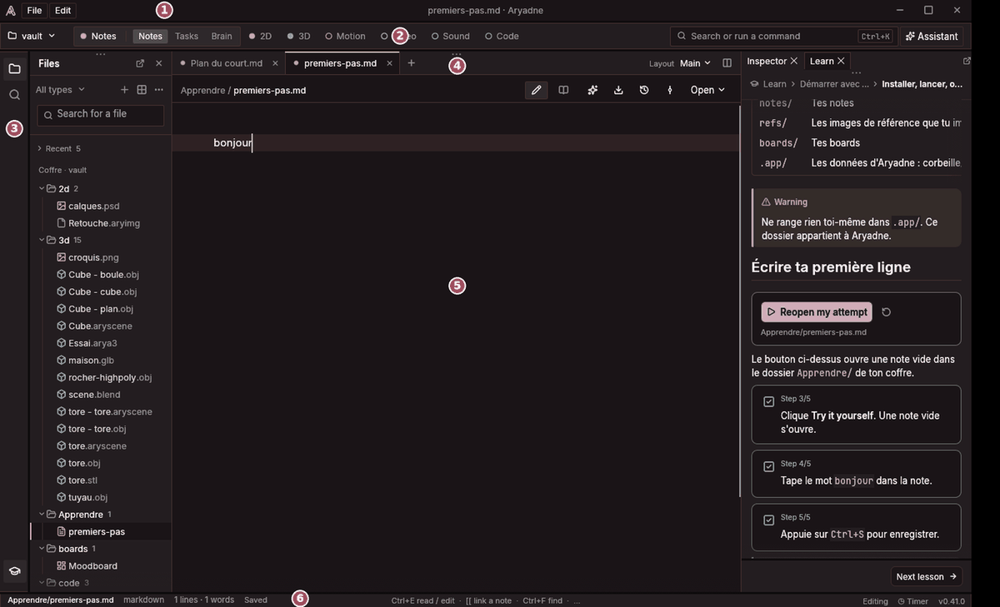
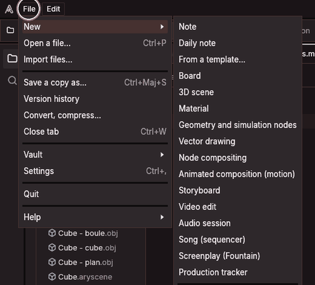
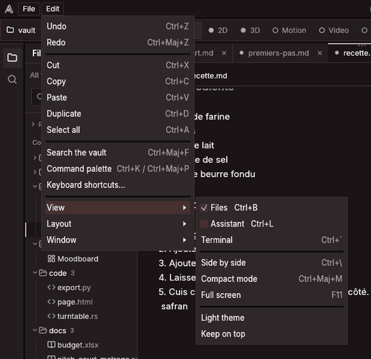
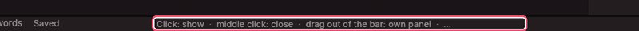

## Ce que tu vas réussir à faire

Tu vas te promener dans toute la fenêtre sans te perdre. À la fin, tu sais où sont les menus, les étapes, les outils, les onglets et l'aide du moment.

```essayer
nouveau: md
nom: tour-de-l-interface
```

```etape
Clique **Try it yourself** pour avoir un fichier ouvert pendant la visite.
verifier: fichier.ouvert = md
```

## La fenêtre, de haut en bas

| Zone | Ce qu'elle contient |
|---|---|
| Barre de titre | Les menus **File** et **Edit**, le nom du fichier, les boutons de la fenêtre |
| Barre des étapes | Le menu du coffre, les étapes, le champ **Search or run a command**, le bouton **Assistant** |
| Rail | Une colonne d'icônes à gauche : les pages de l'étape |
| Onglets | Les fichiers ouverts |
| Document | Le fichier, avec ses panneaux autour |
| Barre du bas | L'aide du moment, l'état d'enregistrement, le minuteur, la version |



## La barre de titre

Aryadne dessine sa propre barre de titre. Elle porte deux menus.

- **File** : créer (**New**), ouvrir, importer, **Version history**, **Vault**, **Settings**, **Help**.
- **Edit** : **Undo**, **Redo**, copier et coller, **Search the vault**, **Command palette**, puis trois sous-menus : **View**, **Layout** et **Window**.

```etape
Ouvre **File**, puis survole **New**. Regarde la liste des fichiers que tu peux créer. Ferme le menu en cliquant à côté.
```



```etape
Ouvre **Edit**, puis survole **View**. Repère **Full screen** et **Light theme** ou **Dark theme**. Ferme le menu.
```



```astuce
Tire la barre de titre pour déplacer la fenêtre. Un double-clic dessus l'agrandit.
```

## Les étapes

Le travail est rangé par étapes du pipeline. Chaque étape est un espace de travail avec ses outils et sa couleur.

| Étape | Raccourci | Outils |
|---|---|---|
| **Notes** | `Ctrl+1` | **Notes**, **Tasks**, **Brain** |
| **2D** | `Ctrl+2` | **Moodboard**, **Retouch**, **Vector**, **Compositing** |
| **3D** | `Ctrl+3` | **Scene**, **Materials**, **Simulation** |
| **Motion** | `Ctrl+4` | **Comps** |
| **Video** | `Ctrl+5` | **Storyboard**, **Edit**, **Review** |
| **Sound** | `Ctrl+6` | **Audio**, **Music** |
| **Code** | `Ctrl+7` | **Code** |

```etape
Clique l'étape **3D** dans la barre des étapes.
verifier: onglet = 3d
```

L'étape active montre ses outils à côté de son nom. En 3D : **Scene**, **Materials**, **Simulation**.


```etape
Clique l'outil **Materials**, puis reviens sur **Scene**.
```

```etape
Reviens aux notes avec `Ctrl+1`.
verifier: onglet = notes
```

Passer d'une étape à l'autre ne ferme rien. Chaque étape garde ses onglets et ses panneaux. Tu la retrouves comme tu l'as laissée.

```raccourci
`Ctrl+1` à `Ctrl+7` : les étapes. `Alt+1`, `Alt+2`, `Alt+3` : les outils de l'étape en cours.
```

Le point devant le nom d'une étape te renseigne. Plein : des fichiers y sont ouverts. Creux : rien n'est ouvert.

## Le rail

À gauche, une colonne étroite d'icônes : c'est le rail. Il montre les pages de l'étape.

- L'icône de dossier, **Files**, est toujours là. Un clic affiche le panneau des fichiers. Un deuxième clic le cache.
- La deuxième icône change selon l'étape : **Search** dans les notes, le son et le code, **References** en 2D, 3D et Motion, **Media** en vidéo.

```etape
Survole chaque icône du rail pour lire son nom. Clique **Files** deux fois : le panneau des fichiers se cache, puis revient.
```

```raccourci
`Ctrl+B` affiche ou cache le panneau des fichiers.
```

## Les onglets

Chaque fichier ouvert a un onglet au-dessus du document.

| Geste | Effet |
|---|---|
| Clic | Afficher le fichier |
| Clic du milieu, ou `Ctrl+W` | Fermer l'onglet |
| `Ctrl+Tab` | Onglet suivant |
| `Ctrl+Maj+Tab` | Onglet précédent |

## La barre du bas

La barre du bas change selon ce que tu fais. Au centre, elle rappelle les raccourcis utiles de l'endroit que tu survoles.

```etape
Pose la souris sur les onglets, puis sur le panneau des fichiers. Lis le texte au centre de la barre du bas : il change.
```



```astuce
La barre n'affiche que trois raccourcis. Survole ce texte pour voir la liste complète.
```

Pour une note ou un fichier de code, la barre affiche aussi **● modified** ou **saved**.

```quiz
Où sont les menus View, Layout et Window ?
- [ ] Dans le menu File.
- [x] Dans le menu Edit.
- [ ] Dans la barre du bas.
explication: La barre de titre ne porte que File et Edit. View, Layout et Window sont des sous-menus de Edit.
```

```quiz
Tu es en 3D et tu passes en Video. Qu'arrive-t-il à tes onglets 3D ?
- [ ] Ils sont fermés.
- [x] Ils restent ouverts dans l'étape 3D.
- [ ] Ils suivent dans l'étape Video.
explication: Chaque étape garde ses onglets et sa disposition.
```

```quiz
Quel raccourci ouvre l'étape Sound ?
- [ ] `Alt+6`
- [x] `Ctrl+6`
- [ ] `Ctrl+S`
explication: Ctrl+1 à Ctrl+7 suivent l'ordre de la barre. Sound est la sixième étape.
```

```defi
Sans la souris, va dans l'étape 2D, choisis l'outil **Vector**, puis reviens aux notes.
indice: `Ctrl+2`, puis `Alt+3`, puis `Ctrl+1`.
```

## Récapitulatif

- Deux menus dans la barre de titre : **File** et **Edit**.
- Sept étapes, chacune avec ses outils, ses onglets et sa couleur.
- La barre du bas rappelle les raccourcis de l'endroit survolé.

Leçon suivante : [Créer et enregistrer un fichier](03-creer-et-enregistrer.md)
