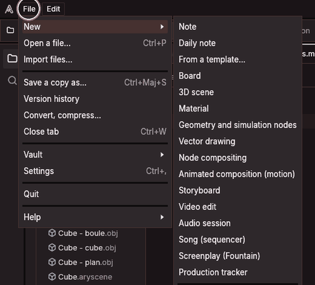
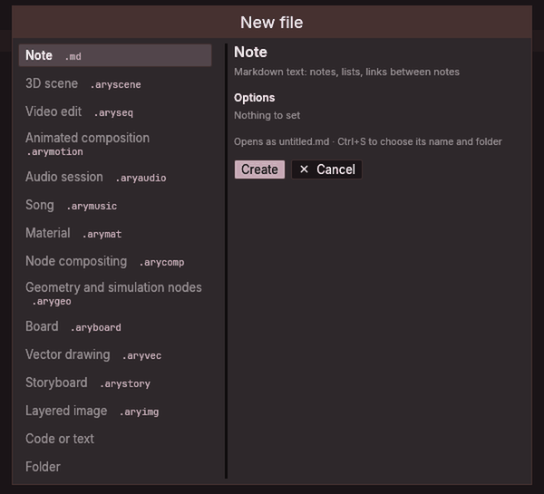
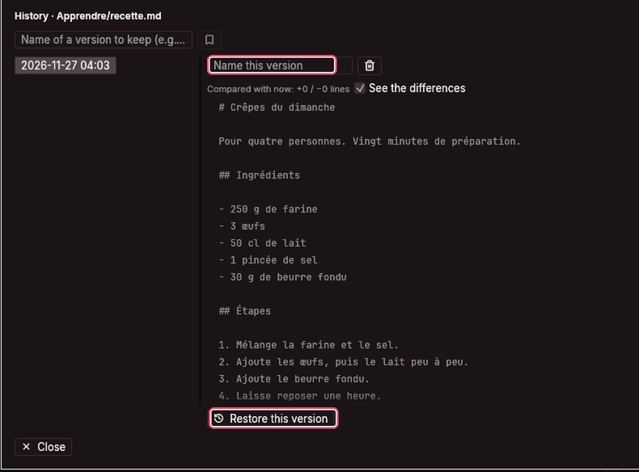

## Ce que tu vas réussir à faire

Tu vas créer une note, lui donner un nom, la modifier, puis revenir à une version d'avant. Les mêmes gestes servent pour une scène 3D, un montage ou un dessin.

## Créer une note

```etape
Ouvre **File › New › Note**. Une note vide s'ouvre sous le nom `untitled.md`.
verifier: fichier.ouvert = md
```



```raccourci
`Ctrl+N` crée une note de la même façon.
```

Un fichier `untitled` n'a pas encore de place dans le coffre. Il la prend au premier enregistrement.

```etape
Tape une phrase qui contient le mot `brouillon`.
verifier: texte.contient = brouillon
```

```etape
Appuie sur `Ctrl+S`. Une fenêtre du système demande le nom et le dossier. Nomme la note `essai` et range-la dans `notes/`.
verifier: fichier.enregistre
```

```attention
Si Aryadne se ferme avant ton premier `Ctrl+S`, rien n'est perdu. Au lancement suivant, la fenêtre **Files to recover** propose **Reopen them** ou **Delete them**.
```

## La fenêtre New file

Pour les autres genres de fichiers, une fenêtre te laisse régler le départ.

```etape
Ouvre **File › New › Other… (choose the kind)**. La fenêtre **New file** s'affiche.
```



Dans cette fenêtre :

1. Clique un genre à gauche. Son extension s'affiche à côté.
2. Règle les options à droite.
3. Clique **Create**, ou appuie sur `Entrée`.

| Genre | Options |
|---|---|
| Scène 3D | **Cube, light and camera** ou **Empty scene** |
| Image à calques | La taille, **White background** ou **Transparent background** |
| Montage, composition | La résolution et les images par seconde |
| Matériau | Un préréglage, ou **Empty (output only)** |
| Code ou texte | Le langage |
| Dossier, board | Un nom |

```etape
Lis les genres proposés, puis ferme la fenêtre avec `Échap`.
```

```astuce
Un fichier s'ouvre dans l'étape qui lui correspond. Créer une scène 3D depuis les notes te fait passer en 3D.
```

## Enregistrer une copie

```essayer
fichier: fichiers/recette.md
```

```etape
Clique **Try it yourself**. Une note `recette` s'ouvre.
verifier: fichier.ouvert = md
```

```etape
Appuie sur `Ctrl+Maj+S` : **Save a copy as…**. Nomme la copie `recette-v2`. L'original reste à sa place et la copie s'ouvre.
```

## Annuler

`Ctrl+Z` annule dans l'éditeur que tu survoles. `Ctrl+Maj+Z` rétablit. Les deux sont aussi dans **Edit** : **Undo** et **Redo**.

```etape
Dans la copie, efface une ligne. Annule avec `Ctrl+Z`.
```

Chaque éditeur a son propre historique d'annulation. Annuler dans une note ne touche pas ta scène 3D.

## Revenir à une ancienne version

Aryadne garde les anciennes versions de chaque fichier texte. Une version est gardée à l'enregistrement, au plus une toutes les 2 minutes. Les 40 dernières restent.

```etape
Ajoute le mot `safran` à la liste des ingrédients, puis enregistre avec `Ctrl+S`.
verifier: texte.contient = safran
```

```etape
Ouvre **File › Version history**. La liste des versions s'affiche.
```



Dans cette fenêtre :

- **Name this version** garde une version tant que tu ne la supprimes pas ;
- **Compare with** montre ce qui a changé par rapport à une autre version, ou à **Now** ;
- **Restore this version** revient à cette version. L'état actuel est gardé avant.

```etape
Donne un nom à la version actuelle avec **Name this version**. Par exemple `avec safran`.
```

```quiz
Tu crées une note avec Ctrl+N. Où est-elle rangée ?
- [ ] Dans `notes/`, sous le nom `Sans titre`.
- [x] Nulle part encore : elle prend son nom et son dossier au premier Ctrl+S.
- [ ] Sur le bureau.
explication: Un fichier `untitled` attend son premier enregistrement pour avoir une place dans le coffre.
```

```quiz
Que fait Ctrl+Maj+S ?
- [ ] Il renomme le fichier.
- [x] Il enregistre une copie sous un autre nom. L'original reste.
- [ ] Il enregistre tous les fichiers ouverts.
explication: Save a copy as… laisse l'original et ouvre la copie.
```

```defi
Change trois lignes de la recette, enregistre, puis retrouve dans l'historique ce qui a été ajouté et retiré.
indice: Dans **Version history**, choisis une version, puis **Compare with** et **Now**.
```

## Récapitulatif

- **File › New** crée un fichier `untitled`. `Ctrl+S` lui donne son nom et son dossier.
- `Ctrl+Maj+S` enregistre une copie.
- **File › Version history** garde et restaure les anciennes versions d'un texte.

Leçon suivante : [La palette de commandes et les raccourcis essentiels](04-palette-et-raccourcis.md)
