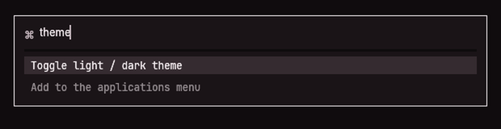
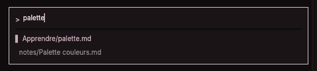
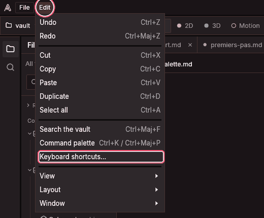
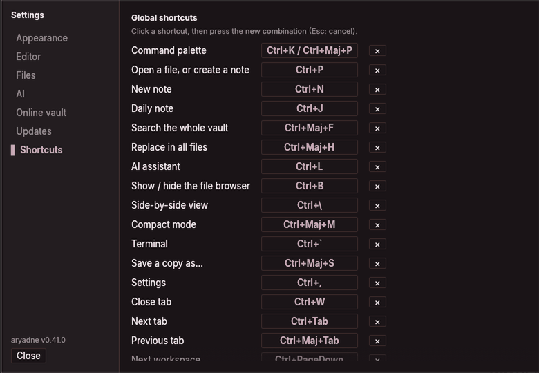

## Ce que tu vas réussir à faire

Tu vas créer un fichier, changer de thème et ouvrir une note sans toucher un menu. La palette de commandes fait tout cela au clavier.

```essayer
nouveau: md
nom: palette
```

```etape
Clique **Try it yourself**.
verifier: fichier.ouvert = md
```

## Ouvrir la palette

```etape
Appuie sur `Ctrl+K`. La palette s'ouvre.
```

Tu peux aussi cliquer le champ **Search or run a command**, dans la barre des étapes.

La palette mélange les commandes et les fichiers du coffre.

1. Tape quelques lettres.
2. Choisis avec `↑` et `↓`.
3. Lance avec `Entrée`. Ferme avec `Échap`.

```etape
Tape `theme` dans la palette. Choisis **Toggle light / dark theme** et appuie sur `Entrée`. Le thème change.
```



```etape
Refais le même geste pour revenir au thème d'avant.
```

```astuce
La recherche est floue. « nvscn » trouve la commande de nouvelle scène 3D. Elle marche en français et en anglais, quelle que soit la langue affichée.
```

## Créer depuis la palette

Tape `new` pour voir tout ce que tu peux créer.

| Commande | Fichier créé |
|---|---|
| **New note** | Une note `.md` |
| **Daily note** | La note du jour, dans `journal/` |
| **New board** | Un board `.aryboard` |
| **New 3D scene** | Une scène `.aryscene` |
| **New vector drawing** | Un dessin `.aryvec` |
| **New video edit** | Un montage `.aryseq` |
| **New file… (pick a kind)** | Ouvre la fenêtre **New file** |

```etape
Ouvre la palette, tape `daily`, lance **Daily note**. La note du jour s'ouvre.
verifier: fichier.ouvert = md
```

## Ouvrir un fichier : Ctrl+P

`Ctrl+P` est la version « fichiers seulement » de la palette.

```etape
Appuie sur `Ctrl+P`, tape `palette`, puis `Entrée`. Ta note d'exercice revient à l'écran.
```



```attention
Si aucun fichier ne correspond à ce que tu as tapé, `Entrée` crée une note de ce nom. Vérifie la liste avant de valider.
```

## Les raccourcis qui servent partout

| Raccourci | Action |
|---|---|
| `Ctrl+K` | Palette de commandes |
| `Ctrl+P` | Ouvrir un fichier |
| `Ctrl+S` | Enregistrer |
| `Ctrl+Z` | Annuler, dans l'éditeur sous la souris |
| `Ctrl+N` | Nouvelle note |
| `Ctrl+B` | Afficher ou cacher le panneau des fichiers |
| `Ctrl+W` | Fermer l'onglet |
| `Ctrl+Tab` | Onglet suivant |
| `Ctrl+1` à `Ctrl+7` | Changer d'étape |
| `Ctrl+Maj+F` | Chercher dans tout le coffre |
| `Ctrl+L` | Ouvrir l'assistant |
| `Ctrl+,` | Réglages |

```attention
Certains raccourcis changent de sens selon l'éditeur sous la souris. Sur la vue 3D, `Ctrl+B` fait un biseau au lieu de cacher les fichiers. La barre du bas te dit toujours ce que font les touches là où tu es.
```

## Changer un raccourci

Les raccourcis globaux se changent. Ceux des éditeurs sont fixes.

```etape
Ouvre **Edit › Keyboard shortcuts…**. Regarde la liste **Global shortcuts**. Ferme la fenêtre sans rien changer.
```





Pour changer un raccourci, clique-le dans cette liste et appuie sur les nouvelles touches. Les conflits sont signalés.

## Ce que la palette ne fait pas

La palette lance les commandes générales. Elle ne lance pas les actions internes d'un éditeur, comme un biseau en 3D ou une coupe au montage. Pour celles-là, passe par les raccourcis de l'éditeur.

```quiz
Quelle différence entre Ctrl+K et Ctrl+P ?
- [x] Ctrl+K montre les commandes et les fichiers. Ctrl+P ne montre que les fichiers.
- [ ] Ctrl+P montre les commandes. Ctrl+K ne montre que les fichiers.
- [ ] Aucune.
explication: Ctrl+P sert à ouvrir un fichier vite. Ctrl+K fait tout le reste aussi.
```

```quiz
Où lire les raccourcis de l'outil que tu utilises ?
- [ ] Dans le menu File.
- [x] Dans la barre du bas.
- [ ] Dans le rail.
explication: La barre du bas suit l'endroit que tu survoles. C'est l'aide la plus à jour.
```

```defi
Avec la palette seule, lance un minuteur de 25 minutes, puis arrête-le.
indice: Tape `timer`. Les commandes sont **Timer: 25 min focus** et **Stop the timer**.
```

## Récapitulatif

- `Ctrl+K` lance une commande ou ouvre un fichier. `Ctrl+P` ouvre un fichier.
- La recherche est floue, en français comme en anglais.
- La barre du bas rappelle les raccourcis de l'éditeur sous la souris.

Leçon suivante : [Les fichiers du coffre](05-fichiers-du-coffre.md)
