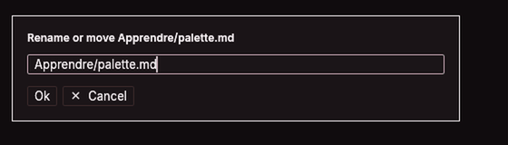
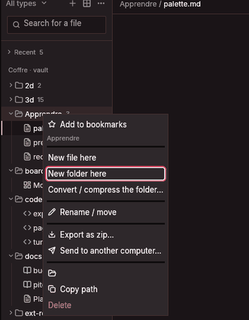

## Ce que tu vas réussir à faire

Tu vas ranger ton coffre : renommer un fichier, le déplacer, le jeter, le récupérer. Puis tu vas importer une image de ton disque.

```essayer
nouveau: md
nom: a-ranger
```

```etape
Clique **Try it yourself**. La note `a-ranger` s'ouvre dans le dossier `Apprendre/`.
verifier: fichier.ouvert = md
```

## Le panneau des fichiers

```etape
Affiche le panneau des fichiers avec `Ctrl+B`, s'il est caché.
```

De haut en bas, il contient :

- un champ **Search for a file** ;
- des filtres par type : notes, images, 3D, code, documents, videos, boards, nodes, other ;
- **Bookmarks** : tes signets ;
- **Recent** : les derniers fichiers ouverts ;
- l'arbre du coffre.

```etape
Dans l'arbre, déplie le dossier `Apprendre`. Clique la note `a-ranger` pour la choisir.
```

```astuce
Le bouton `…` du panneau règle l'affichage : tri, extensions visibles, liste ou grille avec miniatures. **Show the open file** déplie l'arbre jusqu'au fichier affiché.
```

## Renommer et déplacer

| Geste | Effet |
|---|---|
| Double-clic ou `Entrée` | Ouvrir |
| `F2` | Renommer, ou déplacer en tapant un chemin |
| Glisser sur un dossier | Déplacer |
| `Ctrl+clic`, `Maj+clic` | Choisir plusieurs fichiers |
| Clic droit | Le menu du fichier |

```etape
Avec la note choisie, appuie sur `F2`. Renomme-la `rangee`. Valide avec `Entrée`.
```



```etape
Fais un clic droit sur le dossier `Apprendre`, puis **New folder here**. Nomme-le `archives`.
```



```etape
Glisse la note `rangee` sur le dossier `archives`.
```

Déplacer une note ne casse pas ses liens : un lien `[[ ]]` cherche la note par son nom, pas par son dossier.

```attention
Renommer une note, en revanche, ne corrige pas les liens des autres notes. Ils pointent encore vers l'ancien nom. Renomme tôt, avant de tisser beaucoup de liens.
```

## Supprimer et récupérer

`Suppr` n'efface rien du disque. Le fichier part dans la corbeille du coffre, `.app/trash/`.

```etape
Choisis la note `rangee` et appuie sur `Suppr`. Confirme si Aryadne le demande.
```

```etape
La souris sur le panneau des fichiers, appuie sur `Ctrl+Z`. La note revient.
```

```attention
`Ctrl+Z` annule dans l'éditeur que tu survoles. Pour récupérer un fichier, la souris doit être sur le panneau des fichiers.
```

## Importer

Trois façons d'importer : glisser un fichier depuis ton bureau dans la fenêtre, **File › Import files…**, ou la palette.

Aryadne pose alors une question.

| Choix | Effet |
|---|---|
| **Link (keep in place)** | Recommandé. Le fichier reste dans son dossier. Aryadne l'affiche sans le copier |
| **Move into the vault** | Le fichier quitte son dossier d'origine |
| **Copy into the vault** | L'original reste. Le fichier existe en double |

```etape
Glisse une image de ton ordinateur dans la fenêtre d'Aryadne. Choisis **Copy into the vault**.
```

Par défaut, un fichier importé arrive dans `refs/`, ou dans le dossier choisi dans le panneau des fichiers.

```astuce
**Remember this choice** fixe ta réponse. Tu la changes ensuite dans **File › Settings**, onglet **Files**.
```

### Lier un dossier entier

Tu as une banque de textures ou un projet ailleurs sur ton disque ? Lie le dossier. Il apparaît dans le coffre sans être copié.

- Ouvre le menu du coffre, dans la barre des étapes.
- Choisis **Link a folder…**.

Retirer le lien ne supprime jamais l'original.

## Les signets

```etape
Fais un clic droit sur la note `rangee`, puis **Add to bookmarks**. Elle apparaît sous **Bookmarks**, en haut du panneau.
```

## Ce que le clic droit sait faire d'autre

- **Show in folder** : ouvre l'explorateur de ton système à cet endroit.
- **Copy path** : copie le chemin du fichier.
- **Export as zip…** : un fichier ou un dossier dans une archive.
- **Convert, compress…** : change le format d'une image, d'une vidéo ou d'un son.

```quiz
Tu appuies sur Suppr sur un fichier. Où va-t-il ?
- [ ] Il est effacé du disque.
- [x] Dans la corbeille du coffre, `.app/trash/`.
- [ ] Dans la corbeille du système.
explication: Rien n'est effacé. `Ctrl+Z` dans le panneau des fichiers le remet à sa place.
```

```quiz
Tu importes une vidéo de 4 Go que tu veux garder dans ton dossier de rushes. Quel choix ?
- [x] Link (keep in place)
- [ ] Move into the vault
- [ ] Copy into the vault
explication: Le lien montre le fichier dans Aryadne sans le déplacer ni le doubler.
```

```defi
Sauvegarde tout ton coffre dans une archive zip.
indice: **File › Vault › Back up now (zip)**. Les fichiers de plus de 50 Mo et la corbeille ne sont pas inclus.
```

## Récapitulatif

- `Ctrl+B` affiche le panneau des fichiers. `F2` renomme, glisser déplace.
- `Suppr` envoie à la corbeille du coffre. `Ctrl+Z` dans le panneau récupère.
- À l'import, tu choisis de lier, déplacer ou copier.

Leçon suivante : [Panneaux, fenêtres et dispositions](06-panneaux-et-dispositions.md)
