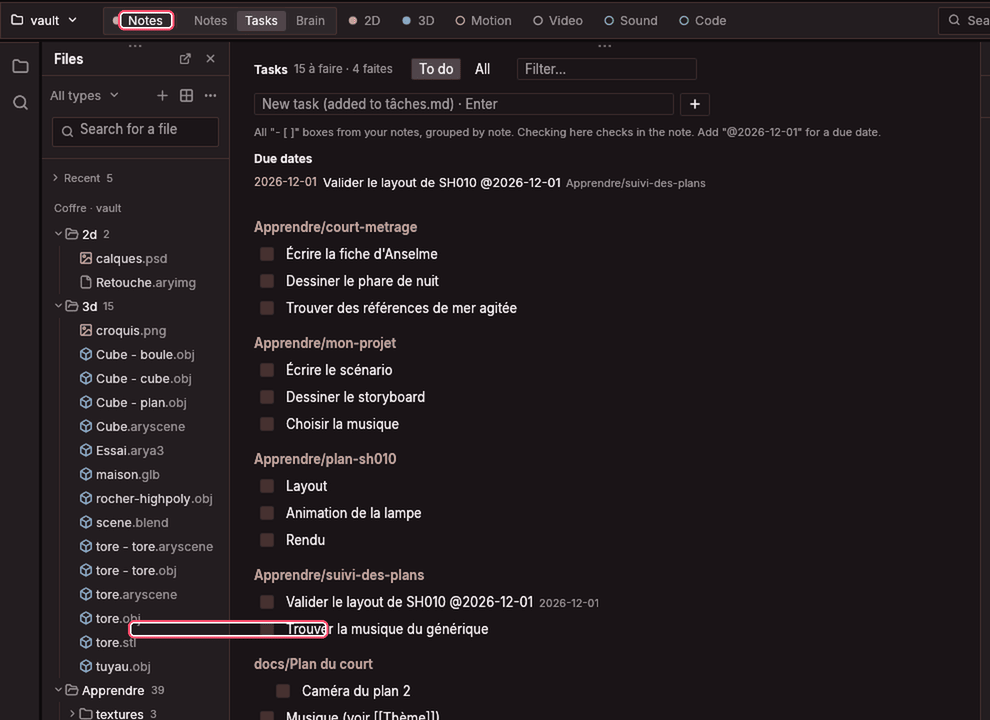
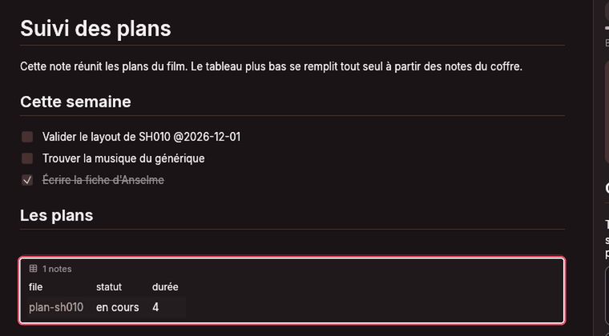
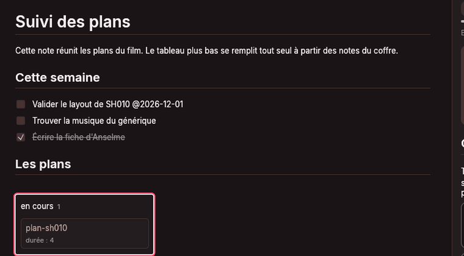

## Ce que tu vas réussir à faire

Tu vas voir toutes les cases à cocher de ton coffre sur une seule page. Puis tu vas écrire un bloc qui liste tes fiches de plans dans un tableau, et le transformer en kanban.

```essayer
fichier: fichiers/suivi-des-plans.md
```

```etape
Clique **Try it yourself**. La note de suivi s'ouvre.
verifier: fichier.ouvert = md
```

## L'outil Tasks

L'étape Notes a trois outils : **Notes**, **Tasks** et **Brain**.

```etape
Clique l'outil **Tasks**, à côté du nom de l'étape. Ou appuie sur `Alt+2`.
```

La page réunit toutes les cases `- [ ]` de toutes tes notes, groupées par note.

- Cocher ici coche dans la note.
- Un clic sur le texte d'une tâche ouvre sa note.
- Le champ du haut ajoute une tâche à la note `tâches.md`. Valide avec `Entrée`.
- Les filtres : **To do**, **All**, **Due dates**, et un champ de texte.

```etape
Coche la tâche « Trouver la musique du générique » dans la page **Tasks**.
```



```etape
Reviens à l'outil **Notes** avec `Alt+1`. Dans la note de suivi, la ligne est cochée.
verifier: texte.contient = [x] Trouver
```

## Une échéance

Un `@` suivi d'une date donne une échéance à la tâche. La date s'écrit année, mois, jour.

```etape
Ajoute une tâche à la note : `- [ ] Rendre SH010 @2026-12-15`
verifier: texte.contient = @2026-12-15
```

Dans la page **Tasks**, le filtre **Due dates** trie les tâches par échéance.

## Un tableau tiré des notes

Un bloc `base` liste les notes du coffre d'après leurs propriétés. Il s'écrit comme un bloc de code.

1. Une ligne avec trois accents graves, suivis du mot `base`.
2. Les lignes du bloc, ci-dessous.
3. Une ligne avec trois accents graves seuls.

```
from: Apprendre/
where: type = plan
columns: file, statut, durée
sort: durée desc
view: table
```

| Ligne | Sens |
|---|---|
| `from` | Un dossier, ou un `#tag`. Plusieurs, séparés par des virgules |
| `where` | Une condition par ligne : `=`, `!=`, `>`, `<`, `>=`, `<=`, `contient` |
| `columns` | Les colonnes. `file` est le nom de la note |
| `sort` | La propriété de tri. `desc` inverse l'ordre |
| `group` | Regroupe par une propriété |
| `view` | `table`, `cartes`, `liste` ou `kanban` |
| `limit` | Le nombre maximum de notes |

```etape
Sous le titre « Les plans », écris le bloc `base` : la ligne d'ouverture, les cinq lignes ci-dessus, la ligne de fermeture.
verifier: texte.contient = base
```

```etape
Passe en lecture avec `Ctrl+E`. Le tableau montre la fiche SH010 de la leçon précédente, avec son statut et sa durée.
```



```astuce
Le tableau est vide ? Vérifie que la fiche `plan-sh010` est bien dans le dossier `Apprendre/` et que son en-tête contient `type: plan`.
```

## Du tableau au kanban

```etape
Reviens au texte. Dans le bloc, remplace `view: table` par `view: kanban`. Ajoute une ligne `group: statut`.
verifier: texte.contient = kanban
```

```etape
Passe en lecture. Chaque statut est une colonne. Glisse la carte SH010 dans une autre colonne.
```



Glisser une carte change la propriété dans la note elle-même. Ouvre la fiche SH010 : son `statut` a changé.

```astuce
Une ligne `order:` fixe l'ordre des colonnes du kanban, même quand elles sont vides. Par exemple : `order: à faire, en cours, validé`.
```

## Toutes les tâches dans une note

Un bloc `tasks` réunit les cases à cocher de tout le coffre, à l'endroit où tu l'écris. Il s'écrit comme le bloc `base`, avec le mot `tasks` après les trois accents graves. Il peut rester vide.

## Un suivi de production tout prêt

**File › New › Production tracker** crée un dossier `Production/` complet : une note `Suivi.md` avec un kanban des plans et un tableau des éléments, plus quelques fiches d'exemple. Tout est fait de notes et de blocs `base`. Tu peux tout modifier.

```quiz
Tu coches une tâche dans la page Tasks. Que devient la note d'origine ?
- [x] Sa case est cochée aussi.
- [ ] Rien : la page Tasks est une copie.
- [ ] La tâche est supprimée de la note.
explication: La page Tasks lit et écrit directement dans les notes.
```

```quiz
Dans un kanban, que se passe-t-il quand tu glisses une carte dans une autre colonne ?
- [ ] Seul l'affichage change.
- [x] La propriété de la note change.
- [ ] La note est déplacée dans un autre dossier.
explication: La colonne correspond à une valeur de propriété. Le glisser l'écrit dans l'en-tête de la note.
```

```defi
Crée deux autres fiches de plans, SH020 et SH030, avec des statuts différents. Fais-les apparaître dans le kanban.
indice: Enregistre une copie de la fiche SH010 avec `Ctrl+Maj+S`, dans le même dossier, puis change son titre et son statut.
```

## Récapitulatif

- L'outil **Tasks** réunit toutes les cases du coffre. `@date` pose une échéance.
- Un bloc `base` liste des notes d'après leurs propriétés.
- `view: kanban` et `group:` font un tableau de cartes à glisser.

Leçon suivante : [Chercher, et voir le coffre en graphe](05-recherche-et-cerveau.md)
