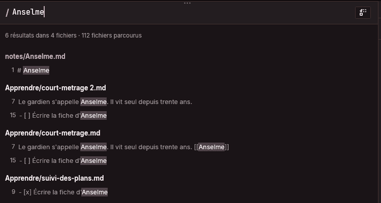
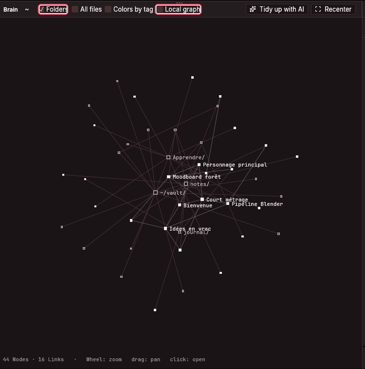

## Ce que tu vas réussir à faire

Tu vas retrouver un mot perdu dans n'importe quel fichier, le remplacer partout, puis regarder ton coffre comme une carte : une bulle par note, un trait par lien.

```essayer
fichier: fichiers/court-metrage.md
```

```etape
Clique **Try it yourself**. La note du court métrage s'ouvre.
verifier: fichier.ouvert = md
```

## Chercher dans une note

```etape
Appuie sur `Ctrl+F`. Tape `phare`. Les passages trouvés sont surlignés dans la note.
```

`Ctrl+F` cherche dans le fichier ouvert seulement.

## Chercher dans tout le coffre

```etape
Appuie sur `Ctrl+Maj+F`. La page de recherche s'ouvre.
```

Tu peux aussi cliquer l'icône de loupe dans le rail, ou passer par **Edit › Search the vault**.

```etape
Tape `Anselme` dans le champ. La liste montre chaque fichier et chaque ligne qui contient ce mot.
```



Ce que cherche cette page :

- les notes, le code, les fichiers texte ;
- les noms de fichiers ;
- les dossiers liés aussi.

Les majuscules et les accents sont ignorés. Il faut au moins 2 caractères.

```etape
Clique un résultat. Le fichier s'ouvre à la bonne ligne.
```

## Chercher par tag

La page de recherche affiche aussi les tags du coffre, sous **Tags**.

```etape
Rouvre la recherche avec `Ctrl+Maj+F`. Efface le champ. Clique un tag : ses notes s'affichent.
```

## Remplacer partout

```attention
Remplacer dans tous les fichiers change beaucoup de notes d'un coup. Chaque fichier texte garde son historique de versions, mais prends le temps de lire la liste avant de valider.
```

`Ctrl+Maj+H` ouvre le remplacement dans tous les fichiers.

1. Tape le mot à chercher.
2. Tape le mot de remplacement.
3. Coche les fichiers à inclure.
4. Clique **Replace all in checked files**.

```etape
Ouvre le remplacement avec `Ctrl+Maj+H`. Cherche `gardien`. Regarde la liste des fichiers proposés. Ferme sans rien remplacer.
```

C'est l'outil à utiliser après avoir renommé une note : remplace `[[Ancien nom]]` par `[[Nouveau nom]]`.

## Le cerveau

L'outil **Brain** dessine le graphe du coffre.

```etape
Clique l'outil **Brain**, ou appuie sur `Alt+3`.
```



```raccourci
`Ctrl+G` ouvre aussi le cerveau, sauf dans un texte, où il va à une ligne, et dans la retouche, le vectoriel et les nodes, où il groupe.
```

| Geste | Effet |
|---|---|
| Molette | Zoom |
| Glisser le fond | Déplacer la vue |
| Glisser une bulle | La déplacer |
| Survol d'une bulle | Montre ses voisines |
| Clic sur une bulle | Ouvre la note |

```etape
Survole la bulle du court métrage. Ses notes liées ressortent.
```

Les options du cerveau :

| Option | Effet |
|---|---|
| **Folders** | Montre aussi les dossiers |
| **All files** | Tous les fichiers, pas seulement les notes |
| **Colors by tag** | Chaque note prend la couleur de son tag le plus courant |
| **Local graph** | La dernière note ouverte et ses voisines, jusqu'à deux liens |
| **Recenter** | Recadre la vue |

```etape
Active **Local graph**. Le graphe ne montre plus que ta dernière note et son entourage.
```

```etape
**Folders** est coché par défaut : les dossiers sont des bulles carrées. Clique un dossier. Tu entres dedans. Le fil d'Ariane en haut te fait remonter.
```

```astuce
Une bulle sans aucun trait est une note isolée. C'est souvent une idée oubliée. Relie-la, ou jette-la.
```

**Tidy up with AI** propose un rangement du dossier affiché. Il demande un modèle d'IA branché. Rien ne bouge avant que tu cliques **Apply**.

```etape
Reviens à l'outil **Notes** avec `Alt+1`.
verifier: onglet = notes
```

```quiz
Quelle différence entre Ctrl+F et Ctrl+Maj+F ?
- [x] Ctrl+F cherche dans le fichier ouvert. Ctrl+Maj+F cherche dans tout le coffre.
- [ ] Ctrl+F cherche dans tout le coffre. Ctrl+Maj+F cherche dans le fichier ouvert.
- [ ] Ils font la même chose.
explication: La touche Maj élargit la recherche à tout le coffre, dossiers liés compris.
```

```quiz
Que montre Local graph ?
- [ ] Tous les fichiers du coffre.
- [x] La dernière note ouverte et ses voisines, jusqu'à deux liens.
- [ ] Seulement les dossiers.
explication: Le graphe local sert à voir l'entourage d'une note sans le bruit du reste.
```

```defi
Trouve dans ton coffre une note que rien ne relie aux autres, et relie-la.
indice: Dans le cerveau, cherche une bulle sans trait. Ouvre-la et écris un lien `[[ ]]` vers une note voisine.
```

## Récapitulatif

- `Ctrl+F` cherche dans le fichier. `Ctrl+Maj+F` cherche dans tout le coffre.
- `Ctrl+Maj+H` remplace dans les fichiers que tu coches.
- L'outil **Brain** montre les notes et leurs liens. **Local graph** resserre sur une note.

Leçon suivante : [Ton premier moodboard](06-premier-moodboard.md)
