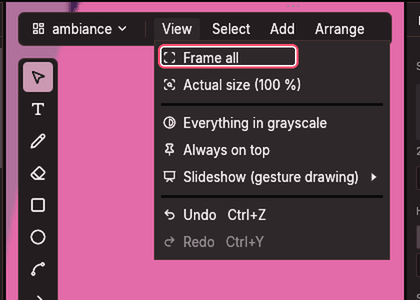
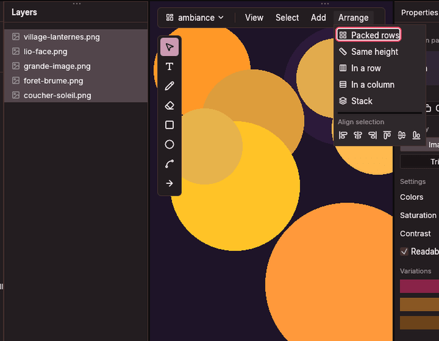

## Ce que tu vas réussir à faire

Tu vas monter une planche d'ambiance : des images de référence, un titre, quelques flèches, le tout rangé proprement. Un board est une toile sans bord, dans l'esprit de PureRef.

Prépare trois à six images sur ton ordinateur. N'importe lesquelles.

```essayer
nouveau: aryboard
nom: ambiance
```

```etape
Clique **Try it yourself**. Un board vide s'ouvre dans l'étape 2D, outil **Moodboard**.
verifier: onglet = 2d
```

## Poser des images

```etape
Glisse tes images depuis ton bureau sur le board. Si Aryadne demande quoi faire des fichiers, choisis **Copy into the vault**.
```

Autres façons d'ajouter une image :

- la glisser depuis le panneau des fichiers ;
- la glisser depuis ton navigateur ;
- la coller avec `Ctrl+V`. Une image collée est enregistrée dans `refs/`.

```attention
Le board ne copie pas les images dans son fichier. Il garde leur chemin. Si tu déplaces une image hors d'Aryadne, elle affiche « File not found ». **Relink to a file…** la retrouve.
```

## Naviguer

| Geste | Effet |
|---|---|
| Molette | Zoom |
| Clic milieu, clic droit ou `Espace` + glisser | Déplacer la vue |
| **View › Frame all** | Tout cadrer |
| **View › Actual size (100 %)** | Taille réelle |

Ici, **View** est le menu du board, dans la barre au-dessus de la toile. Ce n'est pas le sous-menu de **Edit**.

```etape
Zoome sur une image avec la molette. Ouvre ensuite le menu **View** du board et clique **Frame all**.
```



## Choisir, déplacer, redimensionner

L'outil **Select** (`V`) est actif au départ.

| Geste | Effet |
|---|---|
| Clic | Choisir un élément |
| `Maj+clic`, ou tracer un lasso | En choisir plusieurs |
| Glisser | Déplacer |
| Tirer une poignée | Redimensionner, proportions gardées |
| `Alt` + glisser un coin d'une image | Recadrer, sans toucher au fichier |
| `Ctrl+D` | Dupliquer |
| `Suppr` | Supprimer du board |

```etape
Agrandis une image par une de ses poignées. Recadre une autre image avec `Alt` + glisser un coin.
```

## Ranger d'un clic

```etape
Choisis toutes les images avec `Ctrl+A`. Ouvre le menu **Arrange** et clique **Packed rows**.
```



| Commande | Effet |
|---|---|
| **Packed rows** | Range en rangées serrées |
| **Same height** | Toutes les images à la même hauteur |
| **In a row**, **In a column** | En ligne, en colonne |
| **Stack** | Empile |
| **Align selection** | Aligne à gauche, au centre, à droite, en haut, au milieu, en bas |

Sans sélection, **Arrange** agit sur tout le board.

## Écrire et dessiner

| Outil | Touche | Usage |
|---|---|---|
| **Select** | `V` | Choisir, déplacer, redimensionner |
| **Text** | `T` | Poser du texte |
| **Brush** | `B` | Dessiner à main levée. `Maj` : ligne droite |
| **Eraser** | `E` | Gommer les traits |
| **Line** | `L` | Une ligne |
| **Frame** | `R` | Un rectangle |
| **Ellipse** | `O` | Une ellipse |
| **Arrow** | `Maj+A` | Une flèche |

```etape
Appuie sur `T`, clique au-dessus des images, tape un titre pour ta planche.
```

```etape
Appuie sur `Maj+A`. Trace une flèche du titre vers ton image préférée. Reviens à la sélection avec `V`.
```

Clic droit sur un texte : taille, police, couleur, fond, gras, italique, alignement.

## Une note sur le board

```etape
Glisse une de tes notes depuis le panneau des fichiers sur le board. Elle s'affiche comme une carte.
```

Un board accepte aussi une vidéo, un montage ou un modèle 3D. La vidéo se lit sur place. Le modèle se tourne avec `Alt` + glisser.

## Le clic droit sur une image

**Open**, **Foreground**, **Background**, **Flip horizontally**, **Grayscale**, **Remove crop**, **Original size**, **Duplicate**, **Delete**.

```etape
Fais un clic droit sur une image, puis **Flip horizontally**. Annule avec `Ctrl+Z`.
```

## Enregistrer

```etape
Enregistre le board avec `Ctrl+S`.
```

```quiz
Tu supprimes une image du board avec Suppr. Qu'arrive-t-il au fichier de l'image ?
- [x] Rien : il reste dans le coffre.
- [ ] Il part à la corbeille.
- [ ] Il est effacé du disque.
explication: Le board ne contient que des renvois vers les images. Supprimer un élément ne touche pas le fichier.
```

```quiz
Comment recadrer une image sur le board ?
- [ ] Avec l'outil Frame.
- [x] Avec Alt + glisser un coin de l'image.
- [ ] En la redimensionnant avec Maj.
explication: Alt + glisser un coin recadre. Le fichier d'origine reste entier. Remove crop annule le recadrage.
```

```defi
Fais une planche de trois colonnes : personnages, décors, lumière. Chaque colonne a son titre et ses images à la même hauteur.
indice: Choisis les images d'une colonne, puis **Arrange › In a column**. **Same height** les égalise.
```

## Récapitulatif

- Un board est une toile sans bord. Tu y glisses images, notes, vidéos et modèles 3D.
- Le menu **Arrange** range la sélection, ou tout le board.
- Les images sont liées, pas copiées dans le fichier du board.

Leçon suivante : [Références, palettes et croquis de pose](07-references-et-palettes.md)
