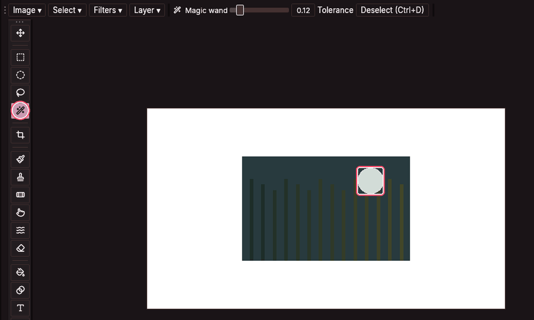
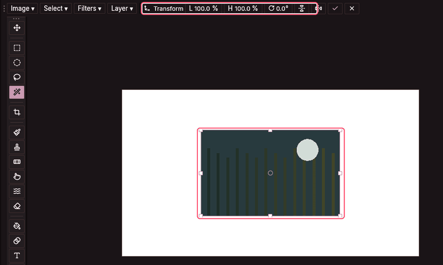

## Ce que tu vas réussir à faire

Tu vas isoler une partie d'une photo, recadrer l'image à un format précis, puis redresser et courber un calque.

Une sélection limite tout ce que tu fais à sa zone : la peinture, les réglages, les filtres.

```essayer
nouveau: aryimg
nom: selections
```

```etape
Clique **Try it yourself**. Ouvre ensuite **Layer ▾ › Layer from an image…** et choisis une photo de ton ordinateur.
verifier: calques >= 2
```

```astuce
Une image déjà dans ton coffre ? Glisse-la depuis le panneau des fichiers sur la toile : elle arrive en nouveau calque.
```

## Les quatre outils de sélection

| Outil | Touche | Usage |
|---|---|---|
| **Rectangle select** | `M` | Un rectangle |
| **Elliptical selection** | `O` | Une ellipse |
| **Lasso** | `L` | Un contour à main levée |
| **Magic wand** | `W` | Les pixels de couleur proche de celui que tu cliques |

```etape
Appuie sur `M`. Trace un rectangle sur la photo.
```

```etape
Appuie sur `B` et peins en travers du rectangle. La peinture s'arrête au bord de la sélection. Annule avec `Ctrl+Z`.
```

## Ajouter, retirer

| Geste | Effet |
|---|---|
| `Maj` pendant le tracé | Ajoute à la sélection |
| `Alt` pendant le tracé | Retire de la sélection |
| `Ctrl+A` | **Select all** : tout sélectionner |
| `Ctrl+D` | **Deselect** : ne plus rien sélectionner |
| `Ctrl+Maj+I` | **Invert selection** : inverser |

```etape
Appuie sur `L`. Entoure un objet de la photo à main levée. Tiens `Maj` et entoure un deuxième objet : il s'ajoute.
```

```etape
Tiens `Alt` et entoure un bout de trop : il est retiré.
```

```etape
Appuie sur `W`. Clique dans une zone de couleur unie, un ciel par exemple. La baguette prend toute la zone.
```



```astuce
La baguette prend trop, ou pas assez ? Change **Tolerance** dans la barre du haut. Plus haut, elle accepte des couleurs plus éloignées.
```

## Inverser pour isoler

Il est souvent plus simple de sélectionner le fond, puis d'inverser.

```etape
Avec le ciel sélectionné, appuie sur `Ctrl+Maj+I`. Tout sauf le ciel est maintenant sélectionné.
```

```etape
Désélectionne avec `Ctrl+D`.
```

`Suppr` efface le contenu de la sélection sur le calque actif.

## Recadrer

```etape
Appuie sur `C` pour l'outil **Crop**. Glisse pour tracer le cadre.
```

La barre du haut propose des formats : **Free**, **Image ratio**, 1:1, 4:3, 16:9, 9:16, 4:5.

```etape
Choisis le format 1:1. Ajuste le cadre sur ton sujet. Appuie sur `Entrée` pour appliquer.
```

`Échap` annule le recadrage avant de l'appliquer. `Ctrl+Z` l'annule après.

## Transformer un calque

```etape
Appuie sur `Ctrl+T` : **Free transform**. Des poignées entourent le calque.
```



| Geste | Effet |
|---|---|
| Glisser à l'intérieur | Déplacer |
| Tirer une poignée | Redimensionner |
| Tourner | Faire pivoter. `Maj` : par pas de 15° |
| **Flip horizontally**, **Flip vertical** | Retourner |
| `Entrée` | Garder |
| `Échap` | Annuler |

```etape
Réduis le calque, tourne-le un peu, puis valide avec `Entrée`.
```

```raccourci
`V` prend l'outil **Move layer** : il déplace le calque actif sans passer par la transformation.
```

## Courber avec une grille

**Warp grid** pose une grille sur le calque. Tu tires ses points pour le courber : un tissu, un reflet, une étiquette sur une bouteille.

```etape
Ouvre **Image ▾ › Warp grid**. Tire deux ou trois points de la grille.
```

```etape
Clique **Reset the grid** pour la remettre droite, ou valide avec `Entrée`.
```

```attention
Un calque de réglage, un calque verrouillé ou un masque ne se transforment pas.
```

## Fluidité

L'outil **Liquify** (`U`) pousse les pixels sous le pinceau. Il sert aux petites déformations locales.

```etape
Appuie sur `U`. Pousse doucement un contour de la photo. Annule avec `Ctrl+Z`.
```

```quiz
Tu traces une sélection en tenant Alt. Que se passe-t-il ?
- [ ] La zone s'ajoute à la sélection.
- [x] La zone est retirée de la sélection.
- [ ] La sélection est inversée.
explication: Maj ajoute, Alt retire.
```

```quiz
Comment valider un recadrage ou une transformation ?
- [x] Avec Entrée.
- [ ] Avec Ctrl+S.
- [ ] En changeant d'outil.
explication: Entrée garde, Échap annule. C'est la même règle pour Crop, Free transform et Warp grid.
```

```defi
Isole un objet de ta photo sur fond transparent.
indice: Sélectionne le fond à la baguette, complète avec `Maj`, puis appuie sur `Suppr`. Cache le calque du fond avec son œil pour voir le résultat.
```

## Récapitulatif

- `M`, `O`, `L`, `W` sélectionnent. `Maj` ajoute, `Alt` retire, `Ctrl+Maj+I` inverse.
- `C` recadre, `Ctrl+T` transforme. `Entrée` valide, `Échap` annule.
- **Warp grid** courbe un calque par une grille de points.

Leçon suivante : [Les masques](04-masques.md)
