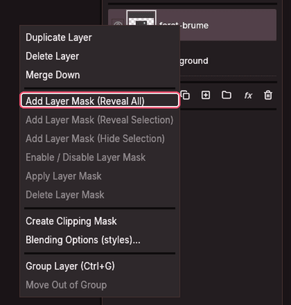
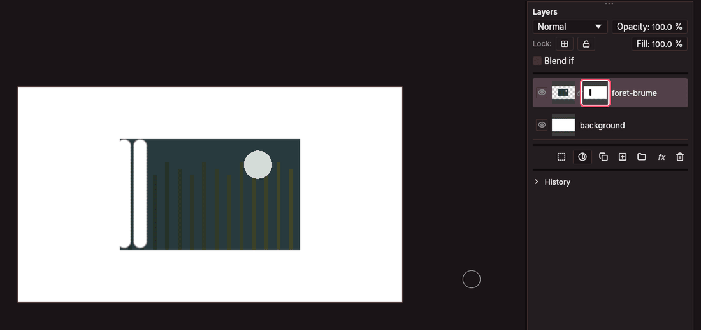

## Ce que tu vas réussir à faire

Tu vas détourer un sujet sans gommer un seul pixel. Tu pourras revenir sur ton détourage à tout moment.

Un masque de fusion est une image grise attachée à un calque. Le blanc montre. Le noir cache. Le gris montre à moitié.

```essayer
nouveau: aryimg
nom: masques
```

```etape
Clique **Try it yourself**. Ajoute une photo avec **Layer ▾ › Layer from an image…**, ou glisse une image du coffre depuis le panneau des fichiers.
verifier: calques >= 2
```

## Ajouter un masque

```etape
Fais un clic droit sur le calque de la photo, dans le panneau **Layers**. Choisis **Add Layer Mask (Reveal All)**.
```



Une deuxième vignette apparaît à côté de celle du calque : c'est le masque. Il est blanc, donc tout est visible.

## Peindre dans le masque

```etape
Clique la vignette du masque. Tu peins maintenant dans le masque, pas dans la photo.
```

```etape
Prends le pinceau avec `B`. Remets noir et blanc avec `D`. Peins en noir sur un bord de la photo : cette zone disparaît.
```



```etape
Échange les couleurs avec `X`. Peins en blanc au même endroit : la photo revient.
```

Voilà toute l'idée. Rien n'est effacé. Tu caches et tu montres.

```astuce
Un pinceau à bord doux donne une transition douce. Baisse **Hardness** pour fondre un sujet dans son fond.
```

## Voir et couper le masque

| Geste sur la vignette du masque | Effet |
|---|---|
| Clic | Peindre dans le masque |
| `Alt+clic` | Voir le masque seul, en noir et blanc |
| `Maj+clic` | Activer ou désactiver le masque |

```etape
Fais `Alt+clic` sur la vignette du masque pour le voir seul. Refais `Alt+clic` pour revenir à l'image.
```

```etape
Fais `Maj+clic` sur la vignette : le masque est coupé, toute la photo revient. Refais `Maj+clic`.
```

```etape
Clique la vignette du calque, à gauche de celle du masque, pour peindre de nouveau dans l'image.
```

## Un masque depuis une sélection

Le plus rapide : sélectionne d'abord, masque ensuite.

```etape
Supprime le masque : clic droit sur le calque, **Delete Layer Mask**.
```

```etape
Sélectionne ton sujet au lasso (`L`). Clic droit sur le calque, puis **Add Layer Mask (Reveal Selection)**.
```

Seul le sujet reste visible. Affine le bord en peignant dans le masque, en noir ou en blanc.

| Commande | Effet |
|---|---|
| **Add Layer Mask (Reveal All)** | Masque blanc : tout est visible |
| **Add Layer Mask (Reveal Selection)** | Seule la sélection reste visible |
| **Add Layer Mask (Hide Selection)** | La sélection est cachée |
| **Enable / Disable Layer Mask** | Coupe ou remet le masque |
| **Apply Layer Mask** | Applique le masque aux pixels, puis le retire |
| **Delete Layer Mask** | Retire le masque. Le calque revient entier |

```attention
**Apply Layer Mask** efface pour de bon ce que le masque cachait. Garde le masque tant que tu peux encore changer d'avis.
```

## Le masque d'écrêtage

Un masque d'écrêtage fait autre chose : le calque n'apparaît que sur les pixels du calque juste en dessous.

```etape
Crée un nouveau calque au-dessus de la photo détourée, avec le bouton **New Layer**.
verifier: calques >= 3
```

```etape
Clic droit sur ce nouveau calque, puis **Create Clipping Mask**.
```

```etape
Peins dessus avec une couleur vive, en débordant largement. La peinture ne se voit que sur le sujet.
```

C'est idéal pour ombrer ou colorer un personnage. **Release Clipping Mask** annule l'écrêtage.

```astuce
Passe ce calque écrêté en mode **Multiply** : tu as un calque d'ombres qui ne déborde jamais.
```

## Le masque d'un groupe

Un groupe peut avoir son masque. Il cache alors tous les calques du groupe d'un coup. La vignette du masque du groupe réagit aux mêmes clics.

```quiz
Dans un masque, que fait le noir ?
- [x] Il cache le calque.
- [ ] Il montre le calque.
- [ ] Il peint le calque en noir.
explication: Le blanc montre, le noir cache. Le gris montre à moitié.
```

```quiz
Quelle différence entre un masque de fusion et un masque d'écrêtage ?
- [x] Le masque de fusion est une image grise que tu peins. Le masque d'écrêtage limite un calque à la forme du calque du dessous.
- [ ] Aucune, ce sont deux noms du même outil.
- [ ] Le masque d'écrêtage efface les pixels.
explication: Le premier se peint. Le second s'appuie sur le calque d'en dessous.
```

```defi
Fonds deux photos l'une dans l'autre avec une transition douce.
indice: Pose la deuxième photo au-dessus. Ajoute-lui un masque blanc. Clique la vignette du masque. Avec un très grand pinceau à **Hardness** basse, peins du noir sur la moitié à cacher.
```

## Récapitulatif

- Un masque cache sans effacer. Blanc montre, noir cache.
- Clic sur la vignette pour y peindre. `Alt+clic` pour le voir, `Maj+clic` pour le couper.
- **Create Clipping Mask** limite un calque à la forme de celui du dessous.

Leçon suivante : [Pinceaux et retouche](05-pinceaux-et-retouche.md)
