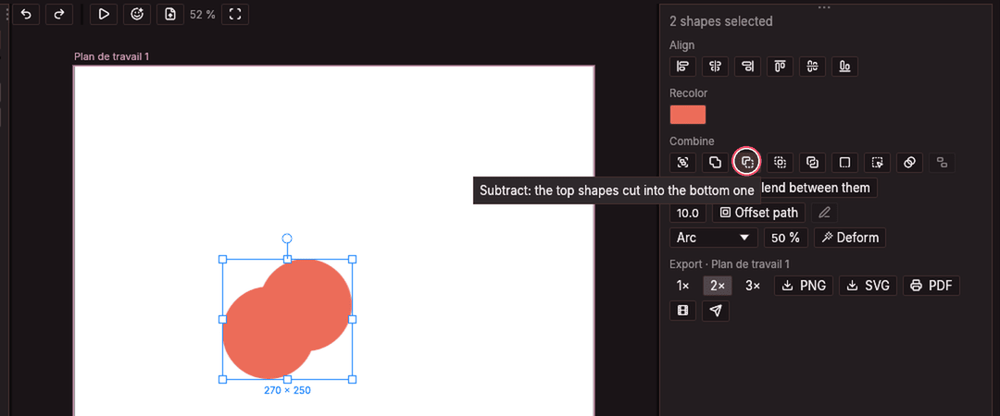
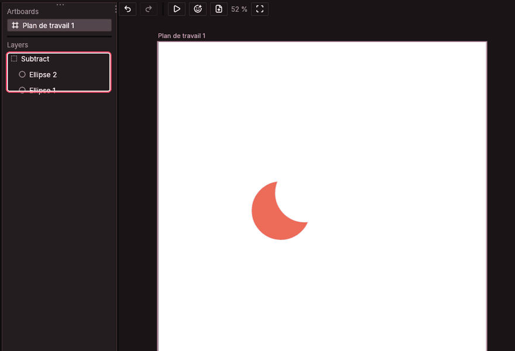

## Ce que tu vas réussir à faire

Tu vas construire un logo à partir de cercles et de rectangles : un croissant de lune, puis un nuage. Aucune plume. Seulement des formes simples que tu combines.

```essayer
nouveau: aryvec
nom: logo
```

```etape
Clique **Try it yourself**.
verifier: fichier.ouvert = aryvec
```

## Soustraire : le croissant

```etape
Trace un cercle avec `E` et `Maj`. Donne-lui un jaune.
verifier: calques >= 1
```

```etape
Duplique-le avec `Alt` + glisser. Décale la copie un peu à droite et en haut. Elle recouvre en partie le premier cercle.
verifier: calques >= 2
```

```etape
Choisis les deux cercles avec `V`. Dans le panneau des propriétés, section **Combine**, clique **Subtract**.
```



La forme du dessus creuse celle du dessous. Il reste un croissant.

## Les opérations

| Opération | Résultat |
|---|---|
| Union | Une seule forme, de la couleur de celle du dessous |
| **Subtract** | Les formes du dessus creusent celle du dessous |
| **Intersect** | Seulement la partie commune |
| Exclude | Tout sauf la partie commune |
| Even-odd | Les formes qui se recouvrent font des trous |

Survole chaque bouton de la section **Combine** pour lire son nom.

## Rien n'est détruit

Ces opérations sont non destructives. Les formes d'origine restent dans un groupe booléen. Tu peux encore les bouger.

```etape
Dans le panneau **Layers (vector)**, déplie le groupe créé. Choisis le cercle du dessus. Déplace-le : le croissant change d'épaisseur.
```



```astuce
Garde tes combinaisons modifiables le plus longtemps possible. Tu ajusteras la forme sans tout refaire.
```

## Unir : le nuage

```etape
À côté du croissant, trace trois cercles qui se chevauchent, et un rectangle arrondi dessous pour la base.
```

```etape
Choisis ces quatre formes. Dans **Combine**, clique l'union. Elles ne font plus qu'une.
```

## Le concepteur de formes

L'outil **Shape builder** (`M`) fait la même chose à la main, zone par zone.

```etape
Trace deux cercles qui se croisent. Choisis-les tous les deux. Appuie sur `M`.
```

```etape
Glisse d'un cercle à l'autre en passant par la zone commune : les zones traversées fusionnent.
```

Avec `Alt`, glisser sur une zone l'efface au lieu de la fusionner.

## Découper et masquer

| Opération | Résultat |
|---|---|
| Clipping mask | La forme du dessous découpe celles du dessus |
| **Opacity mask** | La clarté de la forme du dessous rend le dessus plus ou moins visible. Un dégradé du blanc au noir fait un fondu |

```etape
Trace un rectangle avec un dégradé de couleurs, par-dessus le nuage. Le nuage doit rester dessous : recule-le avec `[` au besoin. Choisis les deux et applique le masque de découpe. Le dégradé ne se voit plus que dans le nuage.
```

## Autres outils sur la sélection

| Outil | Effet |
|---|---|
| **Offset path** | Une copie agrandie ou rétrécie du tracé. Distance négative : vers l'intérieur |
| **Outline stroke** | Le contour devient une forme pleine |
| **Blend between them** | Des formes intermédiaires entre deux formes pleines. Contour et couleur passent en douceur |
| **Deform** | Déforme dans une enveloppe : **Arc**, **Arch**, **Bulge**, **Flag**, **Wave**, **Fish**, **Rise**, **Inflate**, **Twist** |
| **Recolor** | Change une couleur dans toute la sélection |

```etape
Choisis le croissant. Clique **Offset path** avec une petite distance positive : un contour élargi apparaît autour, idéal pour un autocollant.
```

```etape
Trace un petit cercle rouge et un grand carré bleu, éloignés l'un de l'autre. Choisis-les. Clique **Blend between them**.
```

```attention
**Blend between them** demande deux formes pleines. **Deform** ne déforme ni les images ni les groupes, et la forme devient un tracé.
```

## Grouper

`Ctrl+G` groupe la sélection. `Ctrl+Maj+G` dissocie. Un groupe se déplace et se redimensionne d'un bloc.

```etape
Choisis le croissant et le nuage. Groupe-les avec `Ctrl+G`.
```

```quiz
Après un Subtract, peux-tu encore déplacer la forme qui a servi à creuser ?
- [x] Oui : les formes d'origine restent dans le groupe booléen.
- [ ] Non : l'opération est définitive.
- [ ] Seulement avec Ctrl+Z.
explication: Les opérations de la section Combine sont non destructives.
```

```quiz
Que fait Alt avec l'outil Shape builder ?
- [ ] Il duplique la zone.
- [x] Il efface la zone au lieu de la fusionner.
- [ ] Il change la couleur.
explication: Glisser fusionne les zones traversées. Alt + glisser les retire.
```

```defi
Dessine un pictogramme de wifi : trois arcs et un point, à partir de cercles.
indice: Trace des cercles concentriques sans remplissage, avec un contour épais. Découpe-les avec un triangle et **Intersect**. **Outline stroke** change d'abord les contours en formes.
```

## Récapitulatif

- La section **Combine** unit, soustrait, croise, exclut. Les formes d'origine restent modifiables.
- **Shape builder** (`M`) fusionne ou efface des zones à la main.
- **Offset path**, **Blend between them** et **Deform** construisent à partir de formes existantes.

Leçon suivante : [Texte, couleurs partagées, variables et modes](04-texte-couleurs-variables.md)
