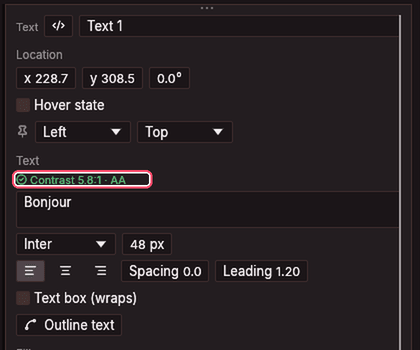
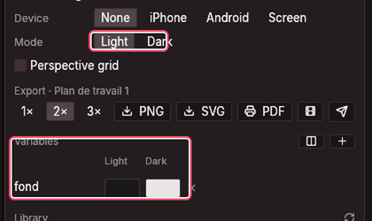

## Ce que tu vas réussir à faire

Tu vas monter une petite carte : un fond, un titre, un bouton. Tu la feras ensuite passer du clair au sombre en changeant un seul réglage.

```essayer
nouveau: aryvec
nom: carte
```

```etape
Clique **Try it yourself**. Trace un rectangle arrondi : le fond de la carte.
verifier: calques >= 1
```

## Poser du texte

```etape
Appuie sur `T` pour l'outil **Text**. Clique dans la carte et tape un titre.
verifier: calques >= 2
```

Un clic pose un texte libre. Glisser trace une zone, avec retour à la ligne.

| Réglage | Effet |
|---|---|
| La police et la taille | |
| **Spacing** | L'espace entre les lettres |
| **Leading** | L'interligne |
| **Text box (wraps)** | Une zone avec retour à la ligne, de **Width** réglable |
| **Outline text** | Le texte devient des tracés, modifiables point par point |

```etape
Choisis le titre avec `V`. Change sa police et sa taille. Monte un peu **Spacing**.
```

```attention
**Outline text** est à sens unique : une fois en tracés, le texte ne se corrige plus au clavier. Fais-le en dernier, sur une copie.
```

### La lisibilité

Aryadne indique le contraste entre le texte et son fond, selon la règle WCAG : 4,5:1 pour un texte courant, 3:1 pour un grand titre.

```etape
Donne au titre une couleur proche de celle du fond. Regarde l'indicateur de lisibilité baisser. Remets une couleur contrastée.
```



### Du texte sur un tracé

Un texte peut suivre une forme. Dans les réglages du texte, le menu à l'icône de courbe liste les tracés du dessin. Choisis-en un : les lettres suivent sa forme.

## Les nuances

Une nuance, **Swatch**, est une couleur nommée du document. Changer la nuance change toutes les formes qui l'utilisent.

```etape
Trace un petit rectangle arrondi sous le titre : un bouton. Donne-lui une couleur vive.
verifier: calques >= 3
```

```etape
Dans la section **Swatches**, clique **Add the document colors as swatches**. Toutes les couleurs du dessin deviennent des nuances.
```

## Les variables et les modes

Une variable va plus loin qu'une nuance. C'est une couleur nommée, avec une valeur par **mode**. Par exemple : claire en mode clair, sombre en mode sombre.

```etape
Dans le panneau **Variables**, clique **New color variable**. Nomme-la `fond`.
```

```etape
Clique **Add a mode**. Une deuxième colonne de valeurs apparaît. Les deux modes s'appellent **Light** (clair) et **Dark** (sombre).
```

```etape
Donne à `fond` un blanc cassé dans le premier mode, et un gris très foncé dans le deuxième.
```



```etape
Crée une deuxième variable, `texte` : presque noir dans le premier mode, presque blanc dans le deuxième.
```

### Lier une forme à une variable

```etape
Choisis le fond de la carte. Dans **Fill**, lie le remplissage à la variable `fond`.
```

```etape
Choisis le titre. Lie son remplissage à la variable `texte`.
```

### Changer de mode

Le mode se règle sur le plan de travail. Les formes liées à une variable prennent sa valeur dans ce mode.

```etape
Choisis le plan de travail. Change son réglage **Mode** pour le deuxième mode. La carte passe au sombre.
```

```astuce
Duplique le plan de travail et mets une copie dans chaque mode. Tu vois le clair et le sombre côte à côte, et tu ne dessines qu'une fois.
```

Supprimer une variable ne casse rien : les formes gardent leur couleur.

## Les styles

Un style enregistre l'allure complète d'une forme : couleurs, contour, effets, police.

```etape
Choisis le bouton. Dans la section **Style**, clique le `+` : **New style from this shape**.
```

```etape
Trace un deuxième bouton. Dans sa section **Style**, choisis ton style dans la liste.
verifier: calques >= 4
```

```etape
Change la couleur du premier bouton, puis clique **Update the style from this shape**. Le deuxième bouton suit.
```

**Detach from style** libère une forme de son style.

## Nuance, variable ou style ?

| Outil | Ce qu'il partage | Quand |
|---|---|---|
| Nuance | Une couleur | Une palette simple |
| Variable | Une couleur par mode | Une interface en clair et en sombre |
| Style | Couleurs, contour, effets, police | Des éléments qui doivent rester identiques |

```quiz
Qu'a une variable de plus qu'une nuance ?
- [ ] Un nom.
- [x] Une valeur par mode.
- [ ] Un contour.
explication: Une variable porte une valeur pour chaque mode. Le plan de travail choisit le mode.
```

```quiz
Où choisit-on le mode clair ou sombre ?
- [ ] Sur chaque forme.
- [x] Sur le plan de travail.
- [ ] Dans les réglages d'Aryadne.
explication: Le réglage Mode du plan de travail s'applique à toutes ses formes liées à une variable.
```

```defi
Ajoute un troisième mode, « contraste », avec un fond noir pur et un texte jaune. Montre les trois modes sur trois plans de travail.
indice: **Add a mode** ajoute une colonne. Un clic droit sur le nom d'un mode permet de le supprimer.
```

## Récapitulatif

- `T` pose du texte. L'indicateur WCAG juge sa lisibilité.
- Une variable a une valeur par mode. Le plan de travail choisit le mode.
- Un style partage toute l'allure d'une forme. **Update the style from this shape** le met à jour partout.

Leçon suivante : [Composants, bibliothèque et mise en page automatique](05-composants-et-bibliotheque.md)
