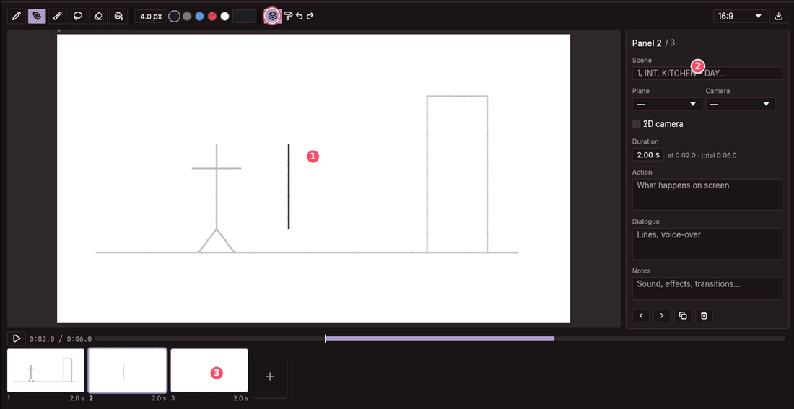

## Ce que tu vas réussir à faire

À la fin de ce parcours, tu sais préparer un film en cases dessinées, le lire comme une animatique et l'envoyer au montage. Tu sais aussi animer un titre, un logo ou un personnage découpé, et l'exporter.

Deux outils, deux étapes :

- le **Storyboard**, dans l'étape **Video**. Fichier `.arystory`.
- les compositions **Comps**, dans l'étape **Motion**. Fichier `.arymotion`.

## Les leçons

### Storyboard

1. [Ton premier storyboard](01-premier-storyboard.md) : 15 min
2. [Les informations d'une case et la caméra 2D](02-infos-et-camera.md) : 15 min
3. [L'animatique, la couleur et l'export](03-animatique-et-export.md) : 15 min

### Motion design

4. [Ta première composition](04-premiere-composition.md) : 15 min
5. [Animer du texte et des tracés](05-texte-et-traces.md) : 15 min
6. [Parenté, caches, masques et effets](06-parente-masques-effets.md) : 15 min
7. [Caméra 2,5D, expressions et export](07-camera-expressions-export.md) : 15 min

## Par où entrer

Les deux moitiés sont indépendantes. Si tu veux seulement animer un titre, commence à la leçon 4.

## Et après

Le parcours suivant est [Vidéo, son et code](../06-video-son-code/index.md). Ton storyboard et tes compositions y servent de matière au montage.
