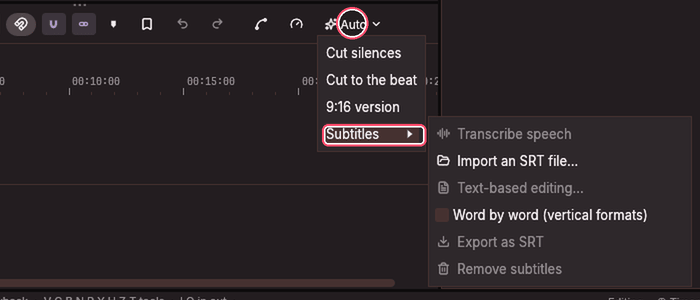
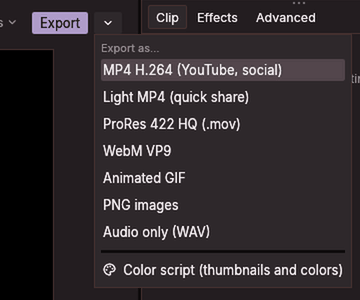

## Ce que tu vas réussir à faire

Tu vas monter une prise de parole sans regarder la timeline : tu liras le texte de ce qui est dit, et tu supprimeras les phrases en trop. Puis tu exporteras le film, avec ses sous-titres.

Il te faut une vidéo où quelqu'un parle. Une minute suffit.

```essayer
nouveau: aryseq
nom: interview
```

```etape
Clique **Try it yourself**. Importe ta vidéo de parole et pose-la sur la timeline avec `E`.
verifier: onglet = video
```

## Ce qu'il faut pour transcrire

La transcription passe par l'un de ces deux moyens :

- **whisper.cpp**, installé sur ton ordinateur avec un modèle. Tout reste chez toi ;
- sinon, l'API de transcription d'OpenAI, si une clé est enregistrée dans les réglages de l'IA.

```attention
Sans l'un ni l'autre, la transcription ne marche pas. Tu peux alors suivre cette leçon avec un fichier de sous-titres existant : **Import an SRT file…**.
```

## Transcrire

```etape
Dans la barre de la timeline, ouvre le menu **Auto**, puis **Subtitles**, puis **Transcribe speech**. Fenêtre large : le bouton **Subtitles** est directement dans la barre. Attends la fin du calcul.
```



Aryadne écoute le mixage et pose une réplique par titre, en bas de l'image.

```etape
Lis le montage. Les sous-titres suivent la parole.
```

| Commande du menu **Subtitles** | Effet |
|---|---|
| **Transcribe speech** | Pose une réplique par titre |
| **Import an SRT file…** | Pose des sous-titres existants |
| **Word by word (vertical formats)** | De gros sous-titres de trois mots. Le mot dit est en couleur vive |
| **Text-based editing…** | Ouvre la transcription en lignes |
| **Export as SRT** | Écrit un fichier SRT à côté du montage |
| **Remove subtitles** | Les retire |

Un sous-titre est un titre comme un autre. Clique-le pour corriger son texte dans l'inspecteur.

## Monter par le texte

```etape
Ouvre **Auto › Subtitles › Text-based editing…**. Une fenêtre liste chaque réplique sur une ligne.
```

Cette commande n'est disponible qu'une fois les sous-titres posés.

```etape
Clique une ligne : la tête de lecture va à cette réplique.
```

```etape
Repère une phrase inutile : une hésitation, une redite. Clique la corbeille de sa ligne. Ce passage est coupé du montage et la suite se resserre.
```

C'est le montage par le texte. Tu lis, tu supprimes, et la vidéo suit.

```etape
Retire deux ou trois autres lignes. Relis le montage avec `Espace`.
```

```astuce
Fais d'abord ce tri au texte, à gros traits. Reviens ensuite sur la timeline pour ajuster les coupes qui claquent, avec `Q` et `W`.
```

## Couper les silences

La barre du montage porte quatre boutons : **Cut silences**, **Cut to the beat**, **Subtitles** et **9:16 version**. Si la fenêtre est étroite, élargis-la pour les voir.

**Cut silences** retire les passages sans voix du clip choisi et de son son lié. La suite se resserre.

```etape
Choisis un clip de parole. Lance **Cut silences**, dans le menu **Auto**. Relis : les blancs ont disparu.
```

```attention
Un montage sans aucun silence fatigue vite. Annule avec `Ctrl+Z` si le résultat est trop haché, et coupe les blancs les plus longs à la main.
```

## D'autres outils automatiques

| Outil | Effet |
|---|---|
| **Cut to the beat** | Choisis une musique : les plans de V1 sont mis bout à bout et chaque coupe tombe sur un temps fort |
| **Split at scene cuts** | Détecte les coupes d'une vidéo déjà montée et sépare chaque plan |
| **9:16 version** | Crée une copie verticale du montage. Chaque plan remplit le cadre, et le cadre suit son sujet |
| **Nest into a sub-sequence** | Les plans choisis partent dans un nouveau montage, qui revient ici comme un seul plan |
| **Sync by sound**, **Make a multicam** | Cale plusieurs prises sur leur son, puis en fait des angles. `1` à `9` coupent vers un angle |

```etape
Lance **9:16 version**, dans le même menu **Auto**. Une copie verticale du montage est créée. Vérifie chaque plan : le sujet est-il dans le cadre ?
```

```attention
La détection du sujet repose sur ce qui bouge et ce qui ressort. Elle peut se tromper. Corrige les plans ratés avec **Position X** dans l'onglet **Clip**.
```

Avec la version verticale, **Word by word (vertical formats)** refait les sous-titres en gros mots, comme sur les réseaux.

## Les gros fichiers

L'aperçu recalcule l'image à la tête de lecture. Avec des fichiers lourds, active les **proxies** : la lecture se sert de copies légères, fabriquées en arrière-plan. L'export garde toujours les originaux.

## Exporter

```etape
Reviens au montage horizontal. Appuie sur `Ctrl+M`, ou clique **Export as…**.
```

| Préréglage | Usage |
|---|---|
| MP4 H.264 | Bonne qualité, lisible partout. Pour YouTube et les réseaux |
| Light MP4 | Un fichier plus petit, pour une revue ou un message |
| ProRes 422 HQ | Pour l'étalonnage, ou un autre logiciel de montage |
| WebM VP9 | Pour le web |
| Animated GIF | 15 images par seconde, 480 px de large |
| PNG images | Une image par trame |
| Audio only (WAV) | Le mixage, sans l'image |

```etape
Choisis le MP4 H.264 et lance l'export.
```



Plusieurs exports se suivent dans une file. Tu peux lancer le MP4, puis le GIF, sans attendre.

```astuce
Pour n'exporter qu'un passage, pose un point d'entrée avec `I` et un point de sortie avec `O` sur la timeline. L'export se limite à ce passage. `Alt+X` retire les deux points.
```

Autres sorties : l'image de la tête de lecture, et **Color script (thumbnails and colors)**, une vignette par plan avec ses couleurs dominantes.

## Les réglages de la séquence

**Sequence settings** règle le **Video format** : la taille de l'image et la cadence. Fais-le avant de monter, pas après.

```quiz
Dans Text-based editing, que fait la corbeille d'une ligne ?
- [ ] Elle supprime seulement le sous-titre.
- [x] Elle coupe ce passage du montage.
- [ ] Elle supprime le fichier vidéo.
explication: Retirer une ligne retire le passage correspondant. La suite se resserre.
```

```quiz
Que faut-il pour que Transcribe speech fonctionne ?
- [x] whisper.cpp installé, ou une clé OpenAI dans les réglages de l'IA.
- [ ] Rien de spécial.
- [ ] Une connexion à Aryadne en ligne.
explication: Sans l'un des deux, la transcription ne marche pas. Import an SRT file reste possible.
```

```quiz
Comment exporter seulement un passage du montage ?
- [ ] En supprimant le reste.
- [x] En posant un point d'entrée (I) et un point de sortie (O).
- [ ] En zoomant dessus.
explication: L'export se fait entre les points I et O quand ils sont posés.
```

```defi
Tire d'une vidéo de parole de deux minutes un extrait vertical de vingt secondes, sous-titré mot par mot.
indice: Transcris, trie au texte, lance **9:16 version**, puis **Word by word (vertical formats)**. Exporte en MP4.
```

## Récapitulatif

- **Subtitles › Transcribe speech** pose les sous-titres. **Text-based editing…** monte en supprimant des lignes.
- **Cut silences**, **Cut to the beat** et **9:16 version** font le gros du travail répétitif.
- `Ctrl+M` exporte, entre les points `I` et `O` s'ils sont posés.

Leçon suivante : [Nettoyer et mixer le son](04-audio.md)
