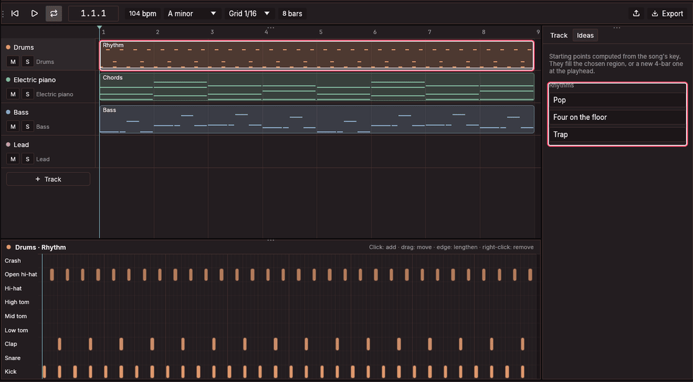

## Ce que tu vas réussir à faire

Tu vas faire tienne une boucle de huit mesures : batterie, accords, basse et mélodie. Aucune notion de solfège n'est demandée : des générateurs d'idées te donnent une base, que tu retouches.

Les instruments sont intégrés. Il n'y a rien à installer.

```essayer
nouveau: arymusic
nom: boucle
```

```etape
Clique **Try it yourself**. Un morceau s'ouvre dans l'étape Sound, outil **Music**.
verifier: onglet = son
```

## L'écran

| Panneau | Contenu |
|---|---|
| **Arrangement (music)** | Les pistes et leurs régions |
| **Piano roll** | Les notes de la région choisie |
| **Transport (music)** | Lecture, tonalité, grille, export |
| **Inspector (music)** | Deux onglets : **Track** et **Ideas** |

Trois mots à retenir. Une **piste** porte un instrument. Une **région** est un bloc posé sur la grille des mesures. Dans une région, il y a des **notes**.

## Ce qui t'attend

Un morceau neuf n'est pas vide. Il arrive avec quatre pistes sur huit mesures : une batterie, des accords, une basse, et une piste de mélodie sans notes.

```etape
Appuie sur `Espace` pour écouter ce point de départ. Appuie encore pour arrêter.
```

## Régler le morceau

Dans le transport :

| Réglage | Effet |
|---|---|
| La tonalité | La note de base, en **Major** ou **Minor** |
| Le tempo | Les battements par minute |
| **Grid** | Le pas de la grille : noire, croche, double croche |
| La longueur | En **Bars**, les mesures |

```etape
Baisse le tempo vers 90. Relis : le morceau est plus posé.
```

## Changer le rythme

```etape
Dans l'arrangement, clique la région de la piste de batterie pour la choisir.
```

```etape
Dans l'inspecteur, ouvre l'onglet **Ideas**. Sous **Rhythms**, clique **Four on the floor**. La région se remplit d'un nouveau rythme.
```



```etape
Écoute. Essaie **Pop** et **Trap**. Garde celui que tu préfères.
```

Les idées remplissent la région choisie. Sans région choisie, elles créent une région de 4 mesures à la tête de lecture.

## Changer les accords

```etape
Clique la région de la piste d'accords. Dans **Ideas**, sous **Chords**, clique une des quatre suites. Écoute. Essaies-en une autre.
```

Les accords sont calculés sur la tonalité du morceau. Ils sonnent juste entre eux.

```etape
Clique la région de la basse. Dans **Ideas**, clique l'idée de basse : la ligne suit les nouveaux accords.
```

## Une mélodie

La quatrième piste est vide. C'est la tienne.

```etape
Clique la piste de mélodie. Place la tête de lecture au début avec `Origine`. Dans **Ideas**, clique **A melody idea**. Une région de 4 mesures apparaît.
```

```etape
Clique encore **A melody idea** : chaque clic en propose une autre. Arrête-toi sur celle qui te plaît.
```

```astuce
Ces générateurs sont de simples règles, pas de l'IA. Ils donnent un point de départ. La musique vient quand tu retouches.
```

## Changer d'instrument, ajouter une piste

L'onglet **Track** de l'inspecteur, section **Instrument**, change l'instrument de la piste choisie : **Piano**, **Electric piano**, **Pluck**, **Pad**, **Bass**, **Lead**, **Drums**.

```etape
Choisis la piste d'accords. Passe son instrument sur **Pad** : une nappe large remplace le piano.
```

Le bouton **+ Track**, sous les pistes, ajoute une piste. Tu choisis son instrument dans le menu.

## Arranger

| Geste dans l'arrangement | Effet |
|---|---|
| Double-clic dans une piste | Une nouvelle région |
| Glisser une région | La déplacer |
| Glisser son bord | L'allonger |
| `Ctrl+D` | Dupliquer la région |
| `Suppr` | La supprimer |

```etape
Choisis la région de mélodie. Duplique-la avec `Ctrl+D` : elle couvre maintenant les 8 mesures.
```

```etape
Supprime la première des deux régions de mélodie avec `Suppr`. La mélodie n'entre plus qu'à la mesure 5. Une boucle qui s'enrichit est plus vivante.
```

Chaque piste a **Mute** et **Solo**. L'onglet **Track** règle son **Volume** et son **Pan**.

```raccourci
`L` : **Start over at the end**. Le morceau reprend au début quand il arrive à la fin.
```

## Retoucher dans le rouleau de piano

Choisis une région. Le **Piano roll** montre ses notes : le temps en largeur, la hauteur en hauteur.

| Geste | Effet |
|---|---|
| Clic | Ajouter une note |
| Glisser une note | La déplacer |
| Glisser son bord | L'allonger |
| Clic droit | La retirer |
| Tracer un cadre | Choisir plusieurs notes |
| `↑` `↓` | Transposer d'un demi-ton. Avec `Maj` : d'une octave |
| `←` `→` | Décaler d'un pas de grille |

```etape
Choisis la région de mélodie. Dans le rouleau, retire deux notes d'un clic droit. Une mélodie respire avec des silences.
```

```etape
Glisse la dernière note vers le haut ou le bas jusqu'à ce que la phrase te plaise. Allonge-la par son bord.
```

Pour la batterie, chaque ligne du rouleau est une pièce : **Kick**, **Snare**, **Clap**, les toms, **Hi-hat**, **Open hi-hat**, **Crash**.

```etape
Choisis la région de batterie. Ajoute un **Crash** sur le premier temps.
```

L'onglet **Track**, section **Region**, propose aussi **-1 octave**, **+1 octave**, **Quantize**, qui cale les notes sur la grille, et **Clear the region**. Pour les notes choisies, **Strength** règle la force de la frappe.

## Exporter

```etape
Clique **Export…**. Choisis WAV ou MP3.
```

**MIDI (.mid)** écrit les notes, pour continuer dans un autre logiciel. Un fichier `.mid` s'importe aussi : ses pistes s'ajoutent au morceau. Seuls les notes et le tempo sont lus.

Ton morceau exporté se pose dans une session audio, un montage, ou une composition Motion.

## Limites à connaître

- Sept instruments, sans réglage de leur son.
- Pas d'enregistrement depuis un clavier MIDI.
- Tout est synthétisé : pas d'échantillons, pas de greffons.
- L'écoute demande ffplay, installé avec ffmpeg.
- Les mesures sont à 4 temps.

```quiz
Que contient une région ?
- [ ] Un instrument.
- [x] Des notes.
- [ ] Un fichier audio.
explication: La piste porte l'instrument. La région, posée sur la grille, contient les notes.
```

```quiz
Sur quoi sont calculées les idées d'accords ?
- [ ] Sur le tempo.
- [x] Sur la tonalité du morceau.
- [ ] Sur un modèle d'IA.
explication: Les idées suivent la tonalité choisie dans le transport. Ce sont des règles simples.
```

```defi
Fais une version « refrain » de ta boucle : mêmes accords, batterie plus chargée, mélodie une octave plus haut.
indice: Duplique tes régions plus loin dans l'arrangement. **+1 octave** dans la section **Region**. Ajoute des **Hi-hat** dans le rouleau.
```

## Récapitulatif

- Une piste porte un instrument, une région porte des notes.
- L'onglet **Ideas** propose rythmes, accords, basse et mélodie dans la tonalité du morceau.
- Le **Piano roll** retouche les notes. **Export…** sort du WAV, du MP3 ou du MIDI.

Leçon suivante : [L'éditeur de code](06-editeur-de-code.md)
