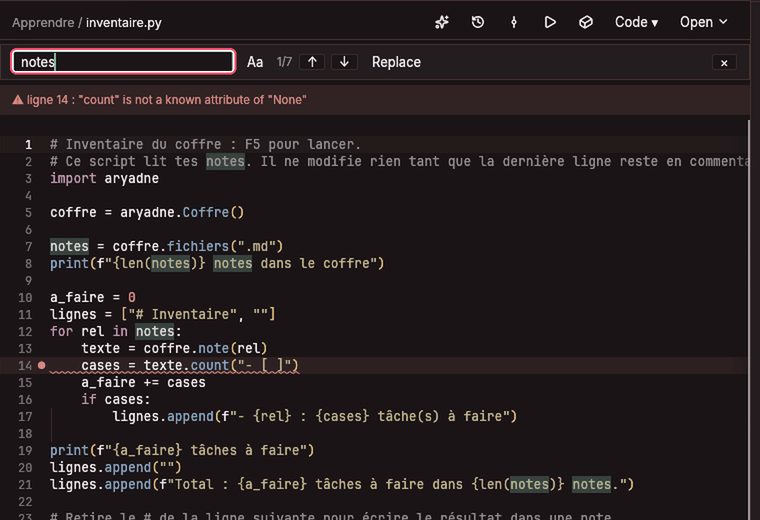

## Ce que tu vas réussir à faire

Tu vas ouvrir un script Python, t'y déplacer vite, le modifier à plusieurs endroits à la fois, et le lancer d'une touche.

Tu n'as pas besoin de savoir programmer pour suivre. Tu vas lire, changer quelques mots, et appuyer sur `F5`.

```essayer
fichier: fichiers/inventaire.py
```

```etape
Clique **Try it yourself**. Le script s'ouvre dans l'étape Code.
verifier: onglet = code
```

## Ce que l'éditeur fait pour toi

| Aide | Comportement |
|---|---|
| La couleur | Mots-clés, textes et commentaires ont chacun leur couleur |
| La fermeture automatique | Une parenthèse ou un guillemet ouvert se referme tout seul |
| `Entrée` | Garde le retrait de la ligne. Ajoute un niveau après `:` ou `{` |
| Les suggestions | Mots du fichier et mots-clés du langage. `Tab` ou `Entrée` insère |
| Le repli | Les flèches dans la marge replient un bloc |

L'éditeur ouvre tout fichier texte : Python, JavaScript, HTML, CSS, JSON, Rust, et les autres.

## Lire le plan du fichier

À droite, l'onglet **Structure** liste les fonctions, les classes et les titres du fichier. Un clic y va.

Dans la marge de gauche, des marques montrent les lignes ajoutées, changées et supprimées depuis l'ouverture du fichier, ou depuis le dernier commit git.

## Chercher et remplacer

```etape
Appuie sur `Ctrl+F`. Tape `notes`. Passe d'un résultat au suivant avec `F3`.
```



```etape
Appuie sur `Ctrl+H`. Le remplacement s'ouvre. Ferme-le avec `Échap` sans rien remplacer.
```

| Raccourci | Effet |
|---|---|
| `Ctrl+F`, puis `F3` et `Maj+F3` | Chercher, suivant, précédent |
| `Ctrl+H` | Remplacer : un par un, ou **Replace all** |
| `Ctrl+G` | Aller à une ligne. Tape son numéro |
| `Ctrl+Maj+O` | Aller à un symbole |

```etape
Appuie sur `Ctrl+G`, tape `10`, puis `Entrée`. Le curseur va à la ligne 10.
```

## Plusieurs curseurs

```etape
Double-clique le mot `lignes` pour le choisir. Appuie sur `Ctrl+D` deux fois : un curseur s'ajoute sur chacune des occurrences suivantes.
```

Avec plusieurs curseurs, ce que tu tapes s'écrit partout à la fois. C'est le moyen le plus rapide de renommer une variable dans un petit script.

```etape
Clique ailleurs dans le texte pour revenir à un seul curseur, sans rien taper.
```

## Manipuler les lignes

| Raccourci | Effet |
|---|---|
| `Ctrl+/` | Commenter ou décommenter la ligne |
| `Ctrl+Maj+D` | Dupliquer la ligne |
| `Alt+↑`, `Alt+↓` | Déplacer la ligne |
| `Tab`, `Maj+Tab` | Indenter, désindenter la sélection |
| `Alt+Z` | Retour à la ligne automatique |
| `Alt+Maj+F` | Formater le fichier, si un formateur est installé |

```etape
Place le curseur sur une ligne `print`. Appuie sur `Ctrl+/` : elle devient un commentaire. Appuie encore : elle redevient du code.
```

```attention
La documentation liste aussi `Ctrl+L` pour choisir la ligne et `Ctrl+Maj+K` pour la supprimer. Ces touches sont aussi des raccourcis globaux : `Ctrl+L` ouvre l'assistant, `Ctrl+K` la palette. Le raccourci global peut passer devant. Si ces gestes te manquent, change les raccourcis globaux dans **Edit › Keyboard shortcuts…**.
```

## Lancer le script

```etape
Appuie sur `F5`. Le script se lance. Sa sortie s'affiche sous l'éditeur : **Program output**.
```

Il faut Python 3 installé sur ton ordinateur. Le script compte tes notes et tes tâches à faire, et l'écrit dans la sortie.

| Extension | Programme lancé par `F5` |
|---|---|
| `.py` | Python |
| `.js`, `.mjs` | Node |
| `.sh` | Bash |
| `.lua` | Lua |
| `.rb` | Ruby |

**Stop** arrête le programme. **Retry** le relance.

## Les erreurs

À l'enregistrement, Python, JavaScript, Bash, Lua et JSON sont vérifiés. La ligne fautive est soulignée. Un point rouge s'affiche. Le message apparaît au survol.

```etape
Efface une parenthèse fermante d'une ligne `print`. Enregistre avec `Ctrl+S`. La ligne est soulignée. Survole-la pour lire le message.
```

```etape
Annule avec `Ctrl+Z` et enregistre de nouveau. Le soulignement disparaît.
verifier: fichier.enregistre
```

Si un serveur de langage est installé sur ton ordinateur, l'éditeur va plus loin : complétion intelligente, erreurs pendant la frappe, `F12` pour aller à une définition. Sans lui, la barre du bas affiche **no lsp** et l'éditeur marche quand même.

## Le terminal

```etape
Appuie sur `` Ctrl+` ``. Le terminal intégré s'ouvre. Tape `python3 --version`, puis `Entrée`.
```

`↑` et `↓` rappellent les commandes précédentes. `Ctrl+C` arrête la commande. **Clear** vide l'affichage.

```attention
Le terminal est simple : une commande à la fois. Les programmes en plein écran, comme vim, n'y marchent pas.
```

## Voir une page web en direct

Pour un fichier HTML ou SVG, **Live preview** ouvre la page dans ton navigateur. Elle se recharge à chaque enregistrement.

```quiz
Que fait F5 dans l'éditeur de code ?
- [ ] Il recharge le fichier.
- [x] Il lance le script ouvert.
- [ ] Il enregistre.
explication: F5 lance le script avec le programme qui correspond à son extension. La sortie s'affiche sous l'éditeur.
```

```quiz
À quoi sert Ctrl+D dans le code ?
- [ ] À dupliquer la ligne.
- [x] À ajouter un curseur sur l'occurrence suivante du mot choisi.
- [ ] À supprimer la ligne.
explication: Ctrl+D pose un curseur de plus. Ctrl+Maj+D duplique la ligne.
```

```defi
Fais écrire le résultat du script dans une note, puis ouvre cette note.
indice: La dernière ligne du script est un commentaire. Retire son `#` avec `Ctrl+/`, enregistre, lance avec `F5`. La note est `Apprendre/inventaire.md`.
```

## Récapitulatif

- `Ctrl+F` cherche, `Ctrl+H` remplace, `Ctrl+G` va à une ligne.
- `Ctrl+D` ajoute un curseur. `Ctrl+/` commente.
- `F5` lance le script. `` Ctrl+` `` ouvre le terminal.

Leçon suivante : [Piloter Aryadne en Python](07-scripts-python.md)
