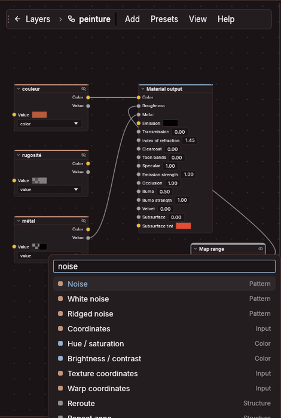
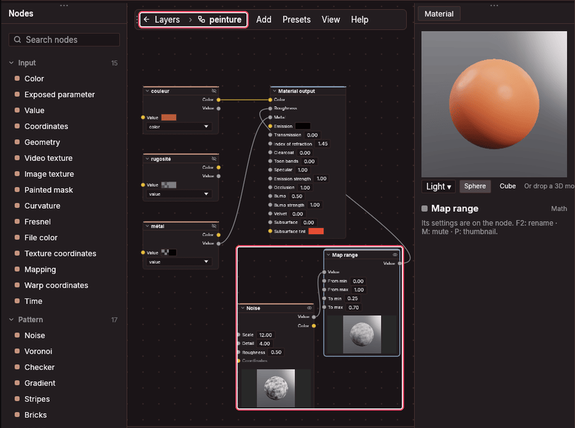

## Ce que tu vas réussir

Tu vas ouvrir une peinture de l'intérieur. Tu vas lui donner une rugosité irrégulière avec un bruit. Puis tu vas faire remonter un curseur jusqu'à la pile.

```essayer
nouveau: arymat
nom: calque-en-nodes
```

## Prépare un calque

```etape
Clique **+**. Nomme le calque « peinture ». Donne-lui un vert, **Roughness** 0,4.
verifier: atelier.calques >= 2
```

## Entre

Trois gestes ouvrent les nodes d'un calque :

- un double-clic sur le calque ;
- l'icône de nodes à droite de sa ligne ;
- l'icône de nodes à côté de **Name**, dans la carte **Layer**.

```etape
Double-clique le calque « peinture ». L'éditeur de nodes remplace la pile.
```

En haut du graphe, le fil d'Ariane indique où tu es : **← Layers**, puis le nom du calque.

Le graphe est court. Trois nodes **Exposed parameter**, nommés couleur, rugosité et métal, entrent dans un node **Material output**. Ce sont eux que tu réglais depuis la pile.

```attention
Dans les nodes, l'aperçu montre **ce calque seul**. De retour sur la pile, il montre le matériau entier.
```

## Un bruit sur la rugosité

Une peinture réelle n'a jamais la même rugosité partout.

```etape
Ajoute un node **Noise** : Maj+A, tape « noise », Entrée. Mets **Scale** à 12.
verifier: graphe.contient = noise
```



```etape
Ajoute un node **Map range**. Relie la sortie **Value** de **Noise** à son entrée **Value**.
verifier: graphe.contient = map
```

**Map range** ramène une valeur d'une plage à une autre. Le bruit va de 0 à 1. Tu le ramènes entre deux rugosités.

```etape
Sur **Map range**, mets **To min** à 0,25 et **To max** à 0,7.
```

```etape
Relie la sortie de **Map range** à l'entrée **Roughness** de **Material output**. Ce lien remplace celui qui venait du paramètre de rugosité.
```



Regarde l'aperçu : le reflet est maintenant taché, plus net par endroits.

## Expose ton propre réglage

Le curseur de rugosité de la pile ne sert plus à rien : son node n'est plus relié. Tu vas en créer un meilleur.

```etape
Choisis le node **Exposed parameter** de la rugosité, celui qui n'est plus relié. Supprime-le avec Suppr.
```

```etape
Ajoute un node **Exposed parameter**. Dans son réglage **Type**, choisis **value**.
verifier: graphe.contient = param
```

```etape
Appuie sur F2 et nomme-le « rugosité max ».
```

```etape
Relie sa sortie **Value** à l'entrée **To max** de **Map range**.
verifier: graphe.liens >= 5
```

```raccourci
F2 : renommer le node choisi. Le nom d'un Exposed parameter devient le nom du curseur dans la pile.
```

## Ressors

Trois gestes ramènent à la pile : le bouton **← Layers**, Échap, ou Tab à la racine du graphe.

```etape
Clique **← Layers**.
```

```etape
Choisis « peinture ». Dans la carte **Parameters**, trouve le curseur « rugosité max ». Bouge-le : l'aperçu suit.
```

Tu viens de faire ce que fait un matériau de Substance Designer : un graphe à l'intérieur, quelques curseurs à l'extérieur.

## L'annulation, niveau par niveau

- Dans les nodes, Ctrl+Z défait les gestes du graphe, un par un.
- Sur la pile, un seul Ctrl+Z défait **tout** ce que tu as changé dans le calque pendant ta visite.

```etape
Sur la pile, fais Ctrl+Z. Le calque redevient un simple remplissage. Fais Ctrl+Maj+Z pour retrouver ton travail.
```

## Quand un calque n'expose rien

Si le graphe d'un calque n'a aucun **Exposed parameter**, la carte **Parameters** l'explique : « This layer exposes no parameter. ». C'est le cas du calque **Graph** d'un matériau neuf.

```quiz
Que montre l'aperçu quand tu es dans les nodes d'un calque ?
- [ ] Le matériau entier.
- [x] Ce calque seul.
- [ ] Le masque du calque.
explication: Dans les nodes, tu juges le calque seul. Le matériau entier se regarde sur la pile.
```

```quiz
Comment un réglage du graphe devient-il un curseur dans la pile ?
- [ ] En le reliant à Material output.
- [x] En passant par un node Exposed parameter, renommé avec F2.
- [ ] En enregistrant le matériau.
explication: Chaque Exposed parameter du graphe d'un calque apparaît dans la carte Parameters, sous son nom.
```

```defi
Expose aussi l'échelle des taches.
indice: Le curseur de la pile va de 0 à 1. Fais-le passer par un Math réglé sur multiply, avec 40 en B, avant l'entrée Scale de Noise.
```

## En trois lignes

- Double-clic pour entrer dans un calque. **← Layers**, Échap ou Tab pour sortir.
- Dans les nodes, l'aperçu montre le calque seul.
- **Exposed parameter** plus F2 : un curseur de plus dans la pile.

[Suite : Un masque en nodes](05-masque-en-nodes.md)
