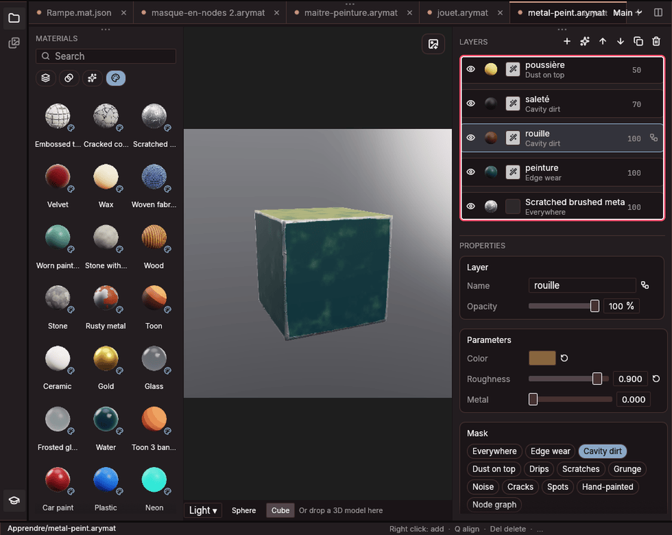
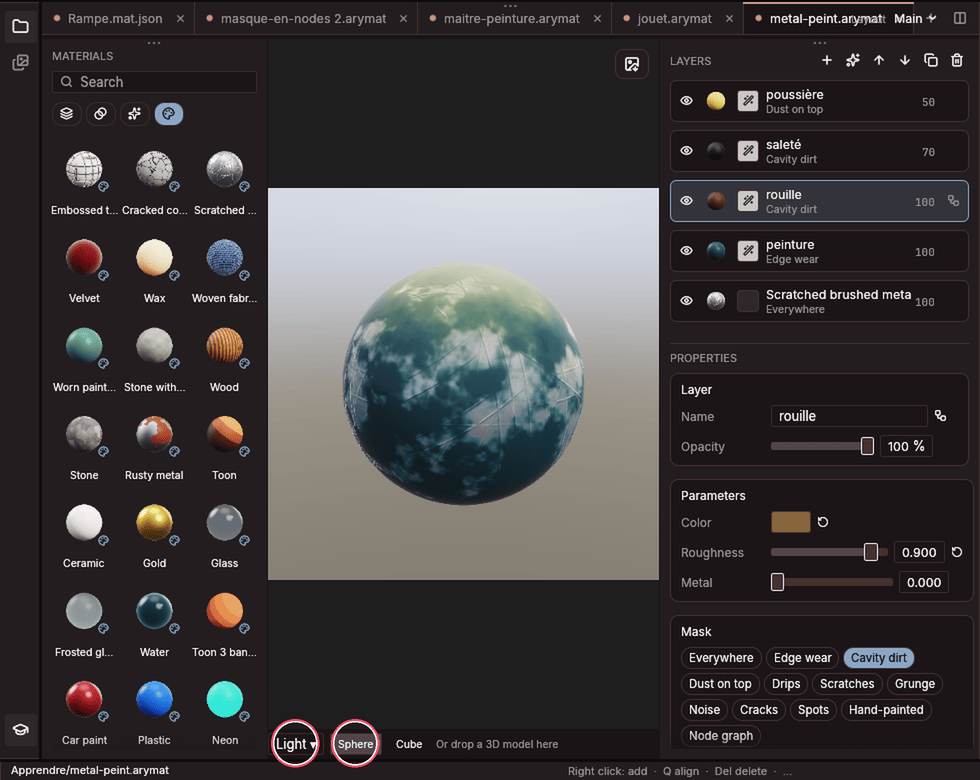

## Ce que tu vas réussir

Un matériau fini : une tôle peinte, écaillée sur ses arêtes, rouillée dans ses creux, sale et poussiéreuse. Cinq calques, dans l'ordre où la vie les aurait posés.

```essayer
nouveau: arymat
nom: metal-peint
```

## Pense en couches de temps

Un objet vieillit par couches. D'abord le métal. Puis la peinture. Puis la rouille, là où la peinture a cédé. Puis la saleté. Puis la poussière, qui se pose en dernier.

Ta pile suit le même ordre, du bas vers le haut.

| Calque | Matière | Masque |
|---|---|---|
| 5. poussière | Beige, mate | **Dust on top** |
| 4. saleté | Brun sombre, mate | **Cavity dirt** |
| 3. rouille | Brun orangé, mate | **Rust in cavities** |
| 2. peinture | Bleu, satinée | **Edge wear** inversé |
| 1. métal | Préréglage | **Everywhere** |

## 1. Le métal

```etape
Passe l'aperçu sur **Cube**.
```

```etape
Dans la bibliothèque, filtre **Presets** et clique **Scratched brushed metal**.
verifier: atelier.calques >= 2
```

```etape
Choisis le calque **Graph** du départ et supprime-le avec la corbeille de l'en-tête. Le métal est maintenant le calque du bas.
```

## 2. La peinture

```etape
Clique **+**. Nomme le calque « peinture ». Donne-lui un bleu pétrole, **Roughness** 0,45, **Metal** 0.
verifier: atelier.calques >= 2
```

```etape
Dans **Mask**, clique **Edge wear** et coche **Invert**. Le métal ressort sur les arêtes.
```

```etape
Règle **Amount** vers 0,6 et **Contrast** vers 0,85 : des éclats francs.
```

```etape
Dans **Breakup**, choisis **Grunge**, avec **Strength** vers 0,6. L'usure n'est plus régulière.
```

### Une peinture qui n'est pas neuve

```etape
Double-clique « peinture » pour entrer dans ses nodes.
```

```etape
Ajoute **Noise**, avec **Scale** à 10, puis **Map range**, avec **To min** à 0,3 et **To max** à 0,65. Relie **Noise** à **Map range**, puis **Map range** à l'entrée **Roughness** de la sortie.
verifier: graphe.contient = map
```

```etape
Reviens à la pile avec **← Layers**.
```

## 3. La rouille

```etape
Clique **+**. Nomme le calque « rouille ». Donne-lui un brun orangé, **Roughness** 0,9, **Metal** 0.
verifier: atelier.calques >= 3
```

```etape
Ouvre **Smart masks** et clique **Rust in cavities**.
```

La rouille se loge dans les creux, par taches. Elle recouvre la peinture, comme dans la réalité.

### Pousse la rouille plus loin, en nodes

```etape
Dans **Mask**, clique la pastille **Node graph**. Le masque s'ouvre en nodes, avec ses réglages déjà en place.
```

```etape
Ajoute un node **Edge wear**, puis un node **Math** réglé sur **maximum**. Relie à **A** ce qui entrait dans **Color** de la sortie. Relie **Edge wear** à **B**. Relie **Math** à **Color**.
verifier: graphe.contient = edgewear
```

La rouille gagne maintenant aussi les arêtes à nu.

```etape
Baisse **Amount** du node **Edge wear** vers 0,3, pour qu'elle reste discrète. Reviens à la pile avec **← Layers**.
```

## 4. La saleté

```etape
Clique **+**. Nomme le calque « saleté ». Donne-lui un brun presque noir, **Roughness** 0,95.
verifier: atelier.calques >= 4
```

```etape
Dans **Mask**, clique **Cavity dirt**. Baisse **Amount** vers 0,3. Baisse **Opacity** du calque à 70 %.
```

## 5. La poussière

```etape
Clique **+**. Nomme le calque « poussière ». Donne-lui un beige clair, **Roughness** 1.
verifier: atelier.calques >= 5
```

```etape
Dans **Mask**, clique **Dust on top**. Baisse **Opacity** à 50 %.
```



## Juge et corrige

```etape
Passe l'aperçu sur **Sphere**, puis ouvre **Light** et choisis **Outdoor**. Regarde les reflets du métal.
```



```etape
Clique l'œil de chaque calque, un par un. Vérifie ce que chacun apporte. Rallume tout.
```

Un calque qui ne change rien quand on l'éteint est de trop, ou trop timide.

```astuce
Trois réglages suffisent pour doser une histoire : **Amount** des masques, **Opacity** des calques, et l'ordre de la pile. Touche à ceux-là avant d'ajouter un calque.
```

## Range ton travail

```etape
Enregistre avec Ctrl+S.
verifier: fichier.enregistre
```

```etape
Clique les étincelles de l'en-tête. Ta pile devient un matériau intelligent, prêt pour un autre objet.
```

## Et après

- Pose-le sur un objet : onglet **Material** de ses propriétés. Voir [la leçon précédente](07-reutiliser-appliquer-cuire.md).
- Rends l'image : [Rendu](../15-animation-rendu/07-rendu.md).
- Fais tout le trajet, de l'objet à l'image finale : [Projet 1 : un objet texturé et rendu](../16-projets/01-objet-texture-et-rendu.md).

```quiz
Pourquoi la poussière est-elle le calque du dessus ?
- [x] Elle se pose en dernier : elle doit recouvrir tout le reste.
- [ ] Les calques mats vont toujours en haut.
- [ ] Le masque Dust on top l'exige.
explication: La pile suit l'ordre du temps. Ce qui arrive en dernier sur l'objet est en haut.
```

```quiz
Tu éteins un calque avec son œil et l'aperçu ne change pas. Que conclure ?
- [ ] Le matériau est cassé.
- [x] Ce calque n'apporte rien : son masque ou son opacité sont trop faibles, ou il est caché par un autre.
- [ ] Il faut enregistrer d'abord.
explication: L'œil est le meilleur outil de diagnostic. Un calque invisible est un calque à corriger ou à retirer.
```

```defi
Décline ton matériau en version « sortie d'usine » : même pile, presque pas d'usure, aucune rouille.
indice: Duplique le fichier avec Ctrl+Maj+S. Baisse Amount de la peinture, éteins la rouille, garde un voile de poussière.
```

## En trois lignes

- Une pile raconte le temps : métal, peinture, rouille, saleté, poussière.
- Les nodes servent aux retouches : une rugosité irrégulière, un masque combiné.
- Les étincelles rangent la pile pour le prochain objet.

Parcours terminé. Pour comprendre les nodes en profondeur, continue avec [Les nodes](../12-noeuds/index.md).
