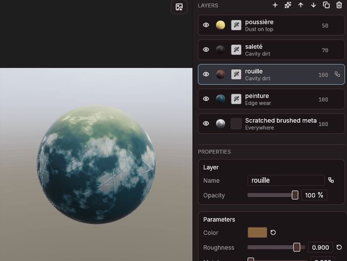

## Ce que tu vas apprendre

Dans Aryadne, tout matériau s'ouvre dans l'**Atelier**. Le fichier porte l'extension `.arymat`. Il s'ouvre dans l'outil **Materials** de l'étape **3D**.

L'Atelier marche en deux temps.

1. **Tu empiles des calques**, comme dans Substance Painter. Une peinture, de la rouille, de la poussière. Chaque calque a un masque qui dit où il se pose.
2. **Tu entres dans un calque** pour voir ses nodes, comme dans Substance Designer. Tu en ressors d'un clic.

Tu n'as pas besoin des nodes pour faire un bon matériau. Ils viennent quand tu veux aller plus loin.



## Les leçons

1. [Découvrir l'Atelier](01-decouvrir-l-atelier.md) : l'écran, la bibliothèque, ton premier calque.
2. [Les calques de remplissage](02-calques-de-remplissage.md) : couleur, rugosité, métal, opacité, ordre.
3. [Les masques](03-les-masques.md) : arêtes, creux, poussière, cassure, masques intelligents.
4. [Entrer dans un calque](04-entrer-dans-un-calque.md) : ses nodes, le fil d'Ariane, les paramètres exposés.
5. [Un masque en nodes](05-masque-en-nodes.md) : construire ton propre masque.
6. [Matériaux maîtres liés](06-materiaux-maitres-lies.md) : un maître, plusieurs matériaux qui le suivent.
7. [Réutiliser, appliquer, cuire](07-reutiliser-appliquer-cuire.md) : matériaux intelligents, objet de la scène, export des textures.
8. [Projet : un métal peint, usé et sale](08-projet-metal-peint.md) : tout mettre ensemble.

## Les mots à connaître

| Mot | Sens |
|---|---|
| Calque | Une couche de matière : sa couleur, sa rugosité, son métal |
| Masque | Là où le calque se voit. Blanc : il se voit. Noir : non |
| Paramètre exposé | Un réglage du graphe d'un calque, visible depuis la pile |
| Matériau maître | Un `.arymat` du coffre dont d'autres matériaux se servent |
| Matériau intelligent | Une pile entière enregistrée, à reposer ailleurs |

```astuce
Pour chercher un réglage précis plus tard, le guide [Atelier : matériaux à calques](../../utilisateur/3d-atelier.md) les liste tous.
```
