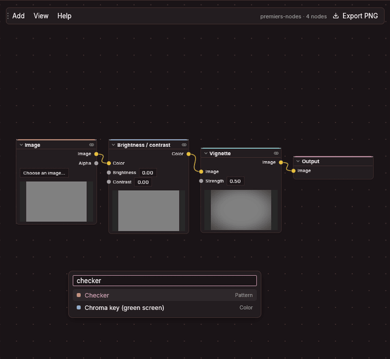
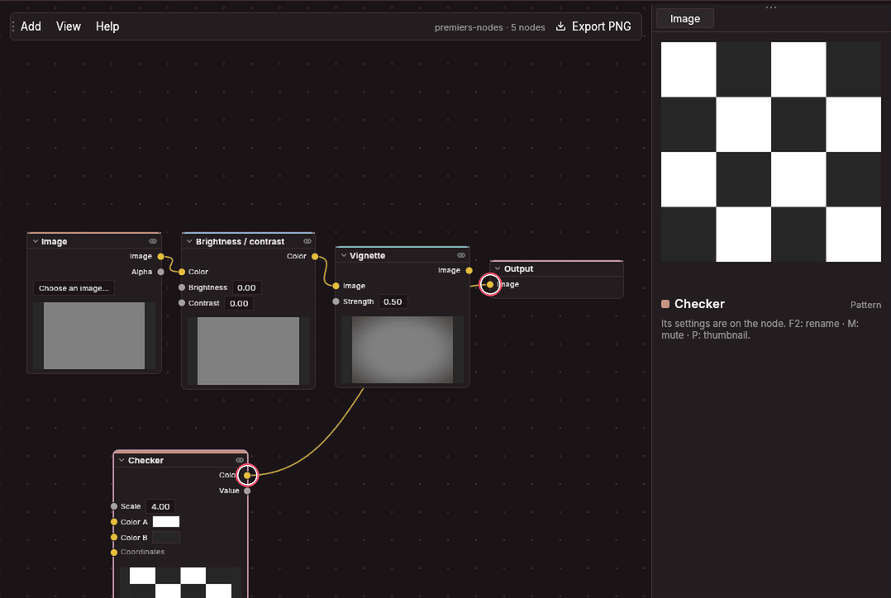
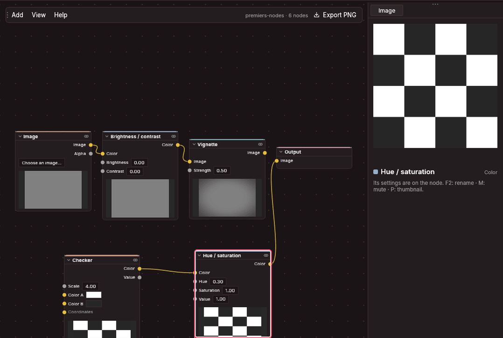

## Ce que tu vas réussir

Tu vas fabriquer une image avec trois nodes : un damier, une couleur, une correction. Tu vas comprendre ce qu'est un lien et ce qu'il transporte.

```essayer
nouveau: arycomp
nom: premiers-nodes
```

Le graphe s'ouvre avec une petite chaîne de départ : **Image**, **Brightness / contrast**, **Vignette**, puis **Output**, la sortie. Ce qui arrive à **Output** est ce que montre l'aperçu.

## Trois mots

| Mot | Sens |
|---|---|
| Node | Une boîte qui fait une chose |
| Prise | Un point d'entrée, à gauche du node, ou de sortie, à droite |
| Lien | Un fil d'une sortie vers une entrée |

Les données vont toujours de gauche à droite.

## Pose ton premier node

```etape
Pose la souris dans le graphe. Appuie sur Maj+A. Tape « checker ». Appuie sur Entrée.
verifier: graphe.contient = checker
```



Un node **Checker** est posé. Il fabrique un damier. Mais l'aperçu ne change pas : rien n'est relié à la sortie.

## Tire ton premier lien

```etape
Glisse de la sortie **Color** de **Checker** jusqu'à l'entrée **Image** de **Output**. Ce lien remplace celui qui venait de **Vignette**.
verifier: graphe.liens >= 1
```



Le damier apparaît dans l'aperçu.

```attention
Une entrée ne reçoit qu'un lien. En tirer un nouveau remplace l'ancien.
```

## Règle une entrée à la main

Une entrée sans lien se règle directement sur le node.

```etape
Sur **Checker**, mets **Scale** à 4. Les cases grossissent.
```

```etape
Clique la pastille de **Color A** et choisis un orange.
```

## Remplace une valeur par un lien

```etape
Ajoute un node **Color** : Maj+A, tape « color », Entrée. Choisis-lui un bleu.
verifier: graphe.contient = color
```

```etape
Relie sa sortie à l'entrée **Color B** de **Checker**.
verifier: graphe.liens >= 2
```

L'entrée **Color B** n'a plus de réglage sur le node : elle prend maintenant ce qui arrive par le lien.

Deux règles à retenir.

- Une **entrée** ne reçoit qu'un seul lien. Un nouveau lien remplace l'ancien.
- Une **sortie** peut nourrir autant d'entrées que tu veux.

```etape
Relie la même sortie de **Color** à l'entrée **Color A** aussi. Le damier devient uni : ses deux couleurs sont la même.
verifier: graphe.liens >= 3
```

## Coupe un lien

```etape
Fais un Ctrl+clic sur le lien qui arrive à **Color A**. Il est coupé, et l'orange revient.
```

```raccourci
Ctrl+clic sur un lien : le couper.
```

## Les types de prises

La couleur d'une prise dit ce qui y passe.

| Type | Ce qui y passe |
|---|---|
| Nombre à virgule | Une valeur |
| Entier | Un nombre entier |
| Vrai / faux | 0 ou 1 |
| Vecteur | Trois nombres : une position, une direction |
| Couleur | Rouge, vert, bleu, alpha |
| Géométrie | Des points et leurs attributs |

Nombres, vecteurs et couleurs se branchent entre eux : la valeur est convertie. Une géométrie ne se branche que sur une géométrie.

```etape
Relie la sortie **Value** de **Checker** à l'entrée **Image** de **Output**. Le damier passe en noir et blanc : un nombre est devenu un gris.
```

```etape
Rebranche la sortie **Color** à la place.
```

## Insère un node dans une chaîne

```etape
Ajoute un node **Hue / saturation**. Relie **Checker** à son entrée **Color**, puis sa sortie à **Output**.
verifier: graphe.contient = hsv
```



```etape
Sur **Hue / saturation**, bouge **Hue**. Toutes les couleurs tournent ensemble.
```

Chaque node reçoit, transforme, et passe au suivant. C'est tout le principe.

## Navigue

| Geste | Effet |
|---|---|
| Molette | Zoom |
| Glisser avec le bouton du milieu | Déplacer la vue |
| F | Cadrer la sélection |
| Origine | Tout cadrer |

Sous chaque node, une miniature montre ce qui en sort. Tu lis le graphe comme une bande dessinée.

```quiz
Combien de liens une entrée peut-elle recevoir ?
- [x] Un seul.
- [ ] Autant qu'on veut.
- [ ] Deux : un par couleur.
explication: Un nouveau lien remplace l'ancien. Ce sont les sorties qui peuvent nourrir plusieurs entrées.
```

```quiz
Tu poses un node, et l'aperçu ne change pas. Pourquoi ?
- [ ] Il faut enregistrer d'abord.
- [x] Rien ne le relie à la sortie.
- [ ] L'aperçu ne suit pas les nodes.
explication: L'aperçu montre ce qui arrive au node de sortie. Un node sans lien vers elle ne compte pas.
```

```defi
Fais un damier dont une couleur sur deux est elle-même un damier plus fin.
indice: Un second Checker, avec un Scale plus grand, relié à Color A du premier.
```

## En trois lignes

- Un graphe va de gauche à droite, jusqu'à la sortie.
- Une entrée se règle à la main, ou reçoit un seul lien.
- La couleur d'une prise dit son type. Nombres, vecteurs et couleurs se convertissent.

[Suite : Ajouter des nodes](02-ajouter-des-nodes.md)
