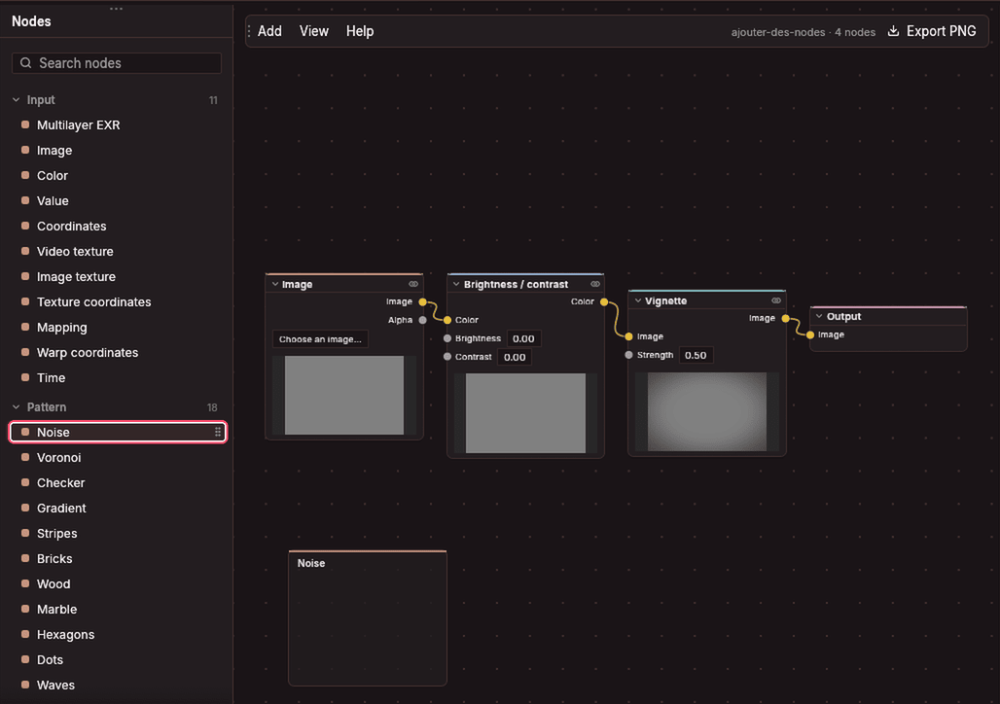
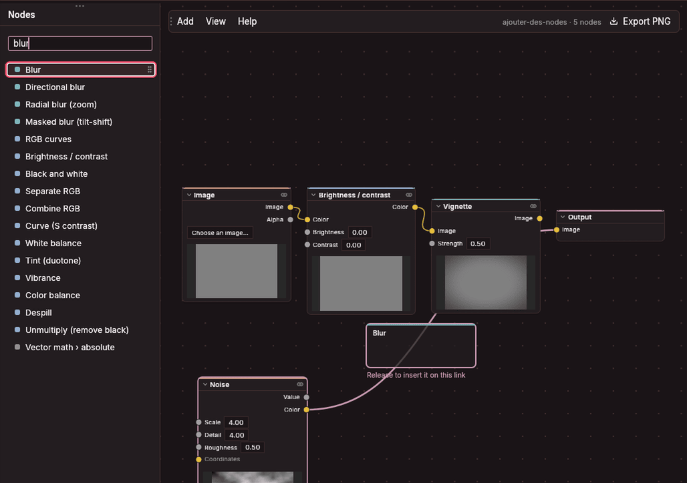
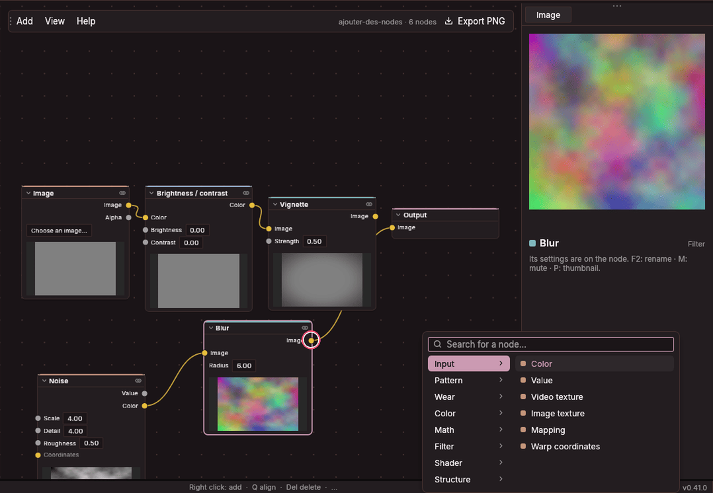

## Ce que tu vas réussir

Tu vas connaître quatre façons de poser un node, et savoir laquelle va le plus vite selon le moment.

```essayer
nouveau: arycomp
nom: ajouter-des-nodes
```

Le graphe s'ouvre avec sa chaîne de départ : **Image**, **Brightness / contrast**, **Vignette** et **Output**. Garde-la : tes liens vers **Output** remplaceront le sien.

## La bibliothèque, à gauche

À gauche du graphe, le panneau **Nodes** liste tous les nodes utilisables ici. Ils sont rangés par catégories.

| Catégorie | Contenu |
|---|---|
| **Input** | Valeurs, couleurs, coordonnées, textures, temps |
| **Pattern** | Bruits et motifs |
| **Color** | Mélanges et corrections de couleur |
| **Math** | Calculs, comparaisons, logique |
| **Filter** | Flous et effets d'image |
| **Structure** | Renvoi, zone de répétition, groupes |
| **Output** | Le node de sortie |

Un graphe ne propose que les nodes qui lui conviennent. Un matériau a en plus **Wear**. Une géométrie a **Geometry** et **Simulation**.

```etape
Clique le nom d'une catégorie pour la replier. Reclique pour la déplier. Le nombre à droite compte ses nodes.
```

## Première façon : glisser depuis la bibliothèque

```etape
Dans **Pattern**, attrape **Noise** et glisse-le dans le graphe. Un fantôme suit la souris. Lâche à gauche de la sortie.
verifier: graphe.contient = noise
```



```etape
Relie la sortie **Color** de **Noise** à **Output**.
verifier: graphe.liens >= 1
```

Un simple clic sur un node de la bibliothèque le pose au centre du graphe.

## Deuxième façon : lâcher sur un lien

```etape
Dans **Filter**, attrape **Blur**. Amène-le sur le lien entre **Noise** et **Output**. Le lien s'allume. Lâche.
verifier: graphe.contient = blur
```



Le flou s'est inséré tout seul : deux liens ont remplacé l'ancien.

Pour s'insérer, un node doit avoir une entrée qui accepte ce qui arrive et une sortie qui convient à la suite. Un node sans entrée ne s'insère pas : il se pose à côté.

```raccourci
Échap pendant un glisser : annuler.
```

## Troisième façon : chercher dans la bibliothèque

```etape
Dans le champ de recherche de la bibliothèque, tape « ramp ». Les meilleurs résultats arrivent d'abord, toutes catégories confondues.
```

La recherche comprend les noms français et anglais. Elle comprend aussi les opérations : tape « multiplier » et tu trouves **Math**.

```etape
Glisse **Color ramp** sur le lien entre **Noise** et **Blur**.
verifier: graphe.contient = colorramp
```

Efface la recherche pour retrouver les catégories.

## Quatrième façon : Maj+A, sous la souris

C'est le geste le plus rapide. Tes yeux ne quittent pas le graphe.

```etape
Pose la souris dans un coin vide du graphe. Appuie sur Maj+A. Le menu s'ouvre sous le curseur, rangé par catégories.
```

```etape
Tape « vig ». Les flèches haut et bas choisissent. Entrée pose le node **Vignette**.
verifier: graphe.contient = vignette
```

```raccourci
Maj+A : ajouter un node sous la souris. Un clic droit dans le vide, puis **Add a node…**, fait pareil.
```

## Le bonus : tirer un lien dans le vide

```etape
Supprime le lien entre **Blur** et **Output** avec un Ctrl+clic.
```

```etape
Relie la sortie de **Blur** à l'entrée **Image** de **Vignette**. Puis relie **Vignette** à **Output**.
verifier: graphe.liens >= 4
```

```etape
Tire maintenant un lien depuis la sortie de **Vignette** et lâche-le dans le vide. Le menu s'ouvre. Choisis **Grain**. Il arrive déjà relié.
verifier: graphe.contient = grain
```



Relie **Grain** à **Output** pour finir la chaîne.

## Une image, directement

Glisse une image depuis le panneau des fichiers vers le graphe : elle devient un node **Image**. Lâchée sur un node qui prend un fichier, elle remplace son image.

## Quelle façon choisir

| Situation | Geste |
|---|---|
| Tu sais le nom | Maj+A, puis tape |
| Tu explores | La bibliothèque, par catégories |
| Tu ajoutes au milieu d'une chaîne | Lâcher sur un lien |
| Tu prolonges une chaîne | Tirer un lien dans le vide |

```quiz
Tu veux insérer un flou entre deux nodes déjà reliés. Le plus direct ?
- [ ] Couper le lien, poser le flou, refaire deux liens.
- [x] Glisser le flou depuis la bibliothèque et le lâcher sur le lien.
- [ ] Dupliquer un des deux nodes.
explication: Lâché sur un lien, un node s'y insère si les types vont ensemble. Le lien s'allume avant que tu lâches.
```

```quiz
Que comprend la recherche de nodes ?
- [ ] Seulement les noms anglais.
- [x] Les noms français, anglais, et les opérations comme « multiplier ».
- [ ] Seulement le début exact du nom.
explication: Tu peux chercher un node par ce qu'il fait. « multiplier » mène à Math.
```

```defi
Reconstruis la chaîne complète sans toucher à la bibliothèque : Noise, Color ramp, Blur, Vignette, Grain, Output.
indice: Pose Noise avec Maj+A, puis prolonge chaque fois en tirant un lien dans le vide.
```

## En trois lignes

- La bibliothèque montre tout, par catégories. Glisse ou clique.
- Lâcher sur un lien insère. Tirer un lien dans le vide prolonge.
- Maj+A cherche sous la souris : c'est le geste de tous les jours.

[Suite : Ranger un graphe](03-ranger-un-graphe.md)
