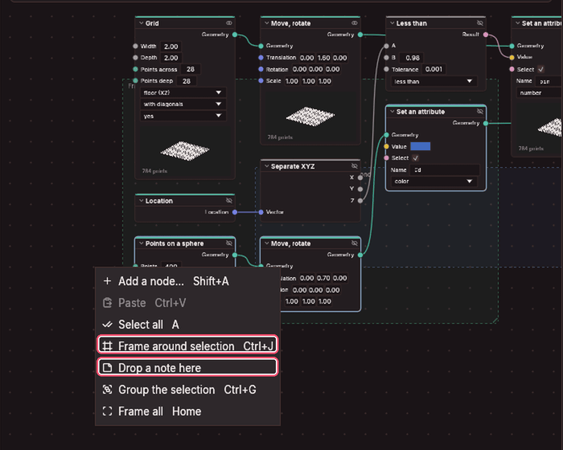
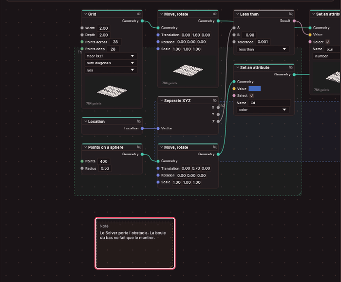

## Ce que tu vas réussir

Tu vas prendre un graphe de seize nodes et le rendre lisible par quelqu'un d'autre. Ou par toi, dans six mois.

```essayer
exemple: tissu sur une boule
```

Tu n'as pas besoin de comprendre la simulation ici. Ce graphe sert seulement de terrain de jeu.

## Sélectionner

| Geste | Effet |
|---|---|
| Clic | Choisir un node |
| Maj+clic | Ajouter à la sélection |
| Glisser dans le vide | Rectangle de sélection |
| A | Tout choisir |
| Alt+A | Ne rien choisir |

```etape
En bas du graphe, trace un rectangle autour des trois nodes de la boule : **Points on a sphere**, **Move, rotate**, **Set an attribute**.
```

## Un cadre autour

```etape
Appuie sur Ctrl+J. Un cadre entoure la sélection.
```

```etape
Double-clique le titre du cadre. Écris « boule (repère visuel) ». Valide avec Entrée.
```

Glisser le titre déplace le cadre et tout ce qu'il contient.

```etape
Fais un clic droit sur le titre du cadre. Choisis une couleur dans le menu.
```

Ce menu propose aussi **Rename frame**, **Write a note in the frame** et **Delete frame**.

## Une note dans le graphe

```etape
Fais un clic droit dans une zone vide du graphe. Choisis **Drop a note here**.
```



```etape
Écris dans la note : « Le Solver porte l'obstacle. La boule du bas ne fait que le montrer. »
```



Une note est un cadre qui porte du texte. Elle se déplace et se colore comme un cadre.

## Renommer un node

Le graphe a trois nodes **Set an attribute**. Impossible de les distinguer d'un coup d'œil.

```etape
Choisis le **Set an attribute** de la rangée du haut. Appuie sur F2. Nomme-le « épingles ».
```

```etape
Renomme de la même façon celui qui suit **Simulation end** : « couleur du tissu ».
```

## Un renvoi pour dompter un fil

Le lien **Time step** qui va du début de la zone au **Solver** passe par-dessus **Forces**.

```etape
Ajoute un node **Reroute** : Maj+A, tape « reroute ». Pose-le sous le node **Forces**.
verifier: graphe.contient = reroute
```

```etape
Relie la sortie **Time step** du début de la zone au **Reroute**. Puis relie le **Reroute** à l'entrée **Time step** du **Solver**.
verifier: graphe.liens >= 18
```

Un renvoi est un simple point de passage. Il ne calcule rien. Il sert à faire contourner un fil.

## Aligner

```etape
Choisis **Forces** et **Solver**. Appuie sur Q. Les nodes choisis sont rangés.
```

```astuce
Maintiens Ctrl pendant que tu déplaces un node : il s'aimante.
```

## Réduire, cacher les miniatures

```etape
Choisis les trois nodes du cadre bleu : **Location**, **Separate XYZ**, **Compare**. Appuie sur H. Ils ne montrent plus que leur en-tête.
```

```etape
Choisis **Grid** et appuie sur P. Sa miniature disparaît. Appuie encore : elle revient.
```

Le menu **View** de la barre du graphe a **Hide thumbnails** et **Show thumbnails** pour toutes les miniatures d'un coup.

## Rendre muet

```etape
Choisis le node « couleur du tissu ». Appuie sur M. Le tissu perd sa teinte dans l'aperçu.
```

Un node muet laisse passer sa première entrée, comme s'il n'était pas là. C'est le moyen de comparer avec et sans, sans rien débrancher. Appuie sur M de nouveau.

## Dupliquer, copier, coller

| Geste | Raccourci |
|---|---|
| Dupliquer | Maj+D ou Ctrl+D |
| Copier, couper, coller | Ctrl+C, Ctrl+X, Ctrl+V |
| Supprimer | Suppr ou X |
| Annuler, rétablir | Ctrl+Z, Ctrl+Maj+Z |

Le copier-coller passe par le presse-papiers du système. Tu peux donc coller dans un autre graphe.

```etape
Choisis **Forces**. Fais Maj+D, pose la copie à côté, puis supprime-la avec Suppr.
```

## Le pense-bête

| Touche | Effet |
|---|---|
| Ctrl+J | Cadre autour de la sélection |
| F2 | Renommer |
| Q | Aligner |
| H | Réduire |
| P | Miniature |
| M | Muet |
| F | Cadrer la sélection |
| Origine | Tout cadrer |

```quiz
Que calcule un node Reroute ?
- [x] Rien : c'est un point de passage.
- [ ] La moyenne de ses entrées.
- [ ] Il recopie la géométrie.
explication: Un renvoi sert à ranger les fils. Avant tout calcul, il est retiré du graphe.
```

```quiz
Tu veux comparer ton graphe avec et sans un node. Le plus simple ?
- [ ] Le supprimer, puis Ctrl+Z.
- [x] Le rendre muet avec M.
- [ ] Le réduire avec H.
explication: Un node muet laisse passer sa première entrée. H ne change que l'affichage.
```

```defi
Entoure de trois cadres titrés les trois rangées du graphe : la forme de départ, la simulation, la boule.
indice: Rectangle de sélection, Ctrl+J, double-clic sur le titre. Donne une couleur différente à chacun.
```

## En trois lignes

- Ctrl+J encadre, F2 renomme, Q aligne.
- Un renvoi fait contourner un fil. Une note explique une intention.
- M compare avec et sans. H et P allègent l'affichage.

[Suite : Les groupes](04-les-groupes.md)
