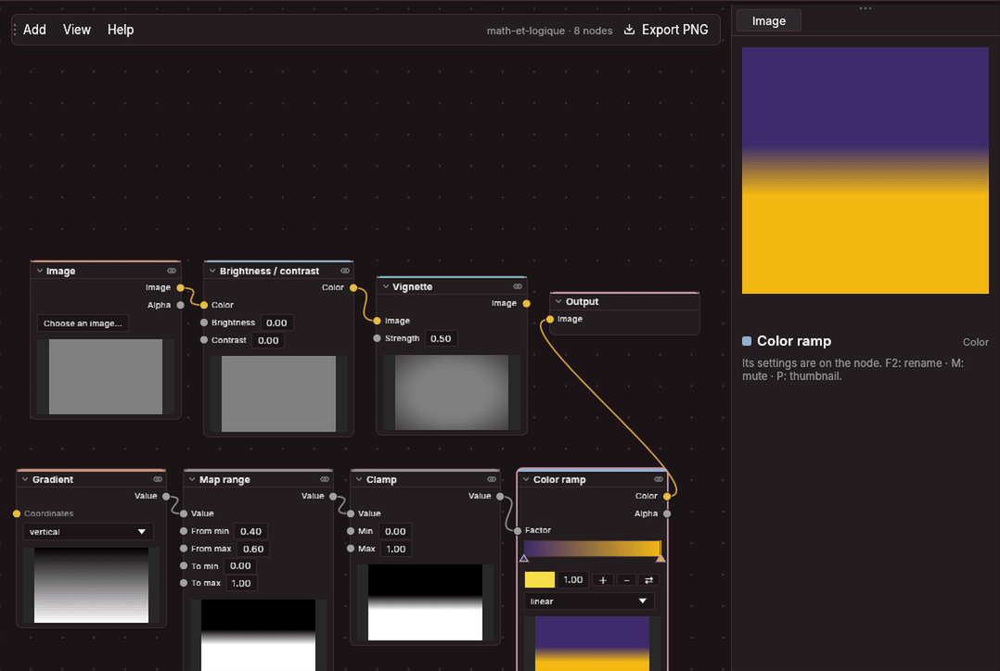

## Ce que tu vas réussir

Tu vas dessiner un coucher de soleil avec des nombres : un dégradé, un seuil, un choix. Aucun motif tout fait, seulement du calcul.

```essayer
nouveau: arycomp
nom: math-et-logique
```

## Une valeur par pixel

Dans un compositing, une valeur est calculée pour chaque pixel. Un node **Gradient** donne par exemple 0 d'un côté de l'image et 1 de l'autre.

```etape
Pose un node **Gradient**. Choisis **Type** : **vertical**. Relie-le à **Output**.
verifier: graphe.contient = gradient
```

L'image est un dégradé du noir au blanc. Chaque pixel porte un nombre entre 0 et 1.

## Math : une opération

```etape
Insère un node **Math** entre **Gradient** et **Output**. Choisis l'opération **multiply** et mets **B** à 2.
verifier: graphe.contient = math
```

Les valeurs sont doublées. La moitié de l'image dépasse 1 : elle est blanche, et le dégradé est plus serré.

```etape
Change l'opération pour **power**, avec **B** à 3. Le dégradé reste longtemps sombre, puis monte vite.
```

**Math** propose une quarantaine d'opérations : **add**, **subtract**, **multiply**, **divide**, **power**, **sine**, **absolute**, **minimum**, **maximum**, et d'autres. Une entrée, une ou deux valeurs, un résultat.

## Map range : changer d'échelle

```etape
Supprime **Math**. À sa place, insère un node **Map range**.
verifier: graphe.contient = map
```

**Map range** ramène une valeur d'une plage à une autre.

```etape
Mets **From min** à 0,4 et **From max** à 0,6. Garde **To min** à 0 et **To max** à 1.
```

Seule la bande entre 0,4 et 0,6 fait encore un dégradé. C'est l'horizon de ton coucher de soleil.

## Clamp : borner

Hors de la bande, les valeurs sortent de 0 à 1. Pour une couleur, c'est sans gravité. Pour un calcul qui suit, ça peut tout fausser.

```etape
Insère un node **Clamp** après **Map range**. Il borne la valeur entre **Min** 0 et **Max** 1.
verifier: graphe.contient = clamp
```

## Des nombres aux couleurs

```etape
Insère un node **Color ramp** après **Clamp**. Règle son dégradé : un bleu nuit d'un côté, un orange de l'autre.
verifier: graphe.contient = colorramp
```



Tu as un ciel.

## Compare : poser une question

**Compare** répond par vrai ou faux. Tu vas demander, pour chaque pixel : « suis-je dans le disque du soleil ? »

```etape
Pose un second **Gradient**, réglé sur **radial**. Il vaut 1 au centre et descend vers 0 aux bords.
verifier: graphe.noeuds >= 6
```

```etape
Pose un node **Compare**. Relie le dégradé radial à **A**. Mets **B** à 0,8 et choisis **greater than**.
verifier: graphe.contient = compare
```

Le résultat est vrai dans un disque autour du centre, faux ailleurs.

## Switch : choisir

```etape
Pose un node **Switch**. Relie **Compare** à **Condition**. Relie le ciel, la sortie de **Color ramp**, à **If false**.
verifier: graphe.contient = switch
```

```etape
Clique la pastille de **If true** et choisis un jaune très clair. Relie **Switch** à **Output**.
```

Un soleil apparaît dans le ciel : là où le test est vrai, le jaune ; ailleurs, le ciel.

## Logic : combiner des tests

Le soleil est entier. Tu vas le couper à l'horizon : « dans le disque **et** au-dessus de la ligne ».

```etape
Pose un second **Compare**. Relie le **Gradient** vertical à son entrée **A**. Mets **B** à 0,5 et choisis **less than**.
```

```etape
Pose un node **Logic**, réglé sur **and**. Relie les deux **Compare** à **A** et **B**. Relie **Logic** à **Condition** de **Switch**.
verifier: graphe.contient = logic
```

```etape
Si c'est la mauvaise moitié du soleil qui reste, passe le second **Compare** sur **greater than**.
```

| **Logic** | Vrai quand |
|---|---|
| **and** | Les deux sont vrais |
| **or** | Au moins un est vrai |
| **not** | A est faux |

## D'autres nodes utiles

| Node | Rôle |
|---|---|
| **Mix values** | Mélange deux nombres selon un **Factor** |
| **Random** | Une valeur au hasard entre **Min** et **Max**, selon une **Seed** |
| **Vector math** | Les mêmes opérations sur des vecteurs, plus **length**, **distance** |
| **Separate XYZ**, **Combine XYZ** | Défaire et refaire un vecteur |

```quiz
Quel node ramène une valeur de la plage 0,4 à 0,6 vers la plage 0 à 1 ?
- [ ] Clamp
- [x] Map range
- [ ] Compare
explication: Map range change d'échelle. Clamp ne fait que couper ce qui dépasse.
```

```quiz
Tu veux une couleur ici et une autre là, selon un test. Quels nodes ?
- [x] Compare, puis Switch.
- [ ] Math, puis Clamp.
- [ ] Deux Color ramp.
explication: Compare pose la question. Switch choisit If true ou If false selon la réponse.
```

```defi
Ajoute un reflet du soleil sous l'horizon : un disque plus sombre, à la même place.
indice: Un troisième Compare pour « sous la ligne », un second Logic réglé sur and, et un second Switch en chaîne.
```

## En trois lignes

- **Math** calcule, **Map range** change d'échelle, **Clamp** borne.
- **Compare** pose une question. **Logic** combine les réponses.
- **Switch** choisit entre deux valeurs selon une condition.

[Suite : Champs et expressions](07-champs-et-expressions.md)
