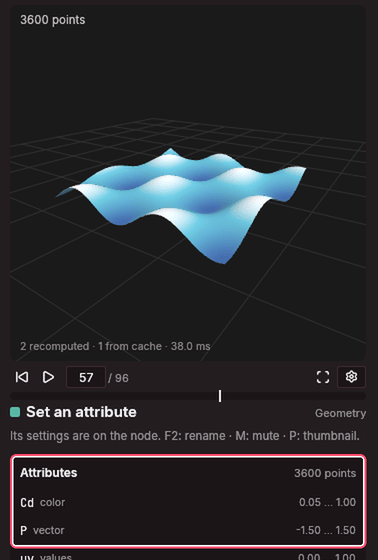
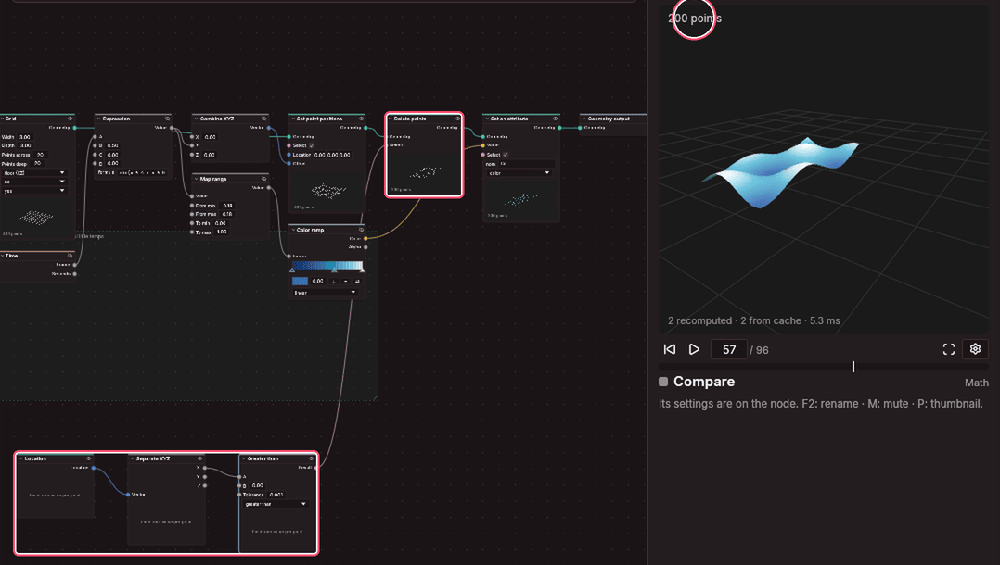

## Ce que tu vas réussir

Tu vas ouvrir une surface de points qui ondule. Tu vas lire ses colonnes. Puis tu vas en couper la moitié avec quatre nodes.

## L'idée

Une géométrie, ce sont des **points**. Chaque point a des **attributs**. Pense à un tableau : un point par ligne, un attribut par colonne.

| Colonne | Type | Ce qu'elle contient |
|---|---|---|
| `P` | vecteur | La position du point |
| `Cd` | couleur | Sa couleur dans l'aperçu |
| `v` | vecteur | Sa vitesse, pendant une simulation |
| `pin` | nombre | 1 si le point est fixe |

Des **arêtes** relient certains points entre eux. Il n'y a pas de faces.

```essayer
exemple: vagues animées
```

## Regarde l'écran

```etape
Vérifie que tu es dans l'outil **Simulation** de l'étape **3D**.
verifier: sous_onglet = simulation
```

Trois zones comptent ici :

- le graphe, au centre ;
- l'aperçu 3D, sur le côté ;
- sous l'aperçu, la barre de lecture.

Dans l'aperçu, glisse pour tourner. Glisse avec le clic droit pour déplacer. La molette zoome. Un double-clic recadre.

```etape
Pose la souris sur l'aperçu. Appuie sur Espace. Laisse la lecture dépasser l'image 30.
verifier: lecture.image >= 30
```

```raccourci
Espace, souris sur l'aperçu : lire ou mettre en pause.
```

## Lis les colonnes

```etape
Clique le node **Grid**. Regarde la carte **Attributes**, sous l'aperçu.
```

Tu vois une seule colonne : `P`, un vecteur. À droite, l'étendue de ses valeurs. En haut, le nombre de points.

```etape
Clique maintenant le node **Set an attribute**, juste avant la sortie.
```



Une colonne `Cd` est apparue. C'est une couleur. Ce node l'a écrite. Chaque node reçoit le tableau, le change, et le passe au suivant.

```astuce
Pour voir dans l'aperçu ce qui sort d'un node précis : clic droit sur lui, puis **Preview node**. Pour revenir à la sortie, refais un clic droit et choisis **Back to full material**. Le libellé parle de matériau, mais il vaut aussi ici.
```

## Change la source

```etape
Sur le node **Grid**, mets **Points across** à 20 et **Points deep** à 20.
```

La surface a moins de points. La ligne sous l'aperçu le confirme. Elle dit aussi combien de nodes ont été **recomputed** et combien viennent **from cache** : seul ce qui dépend du changement est refait.

## Coupe la moitié des points

Tu vas choisir les points dont X est positif, puis les supprimer.

```etape
Ajoute un node **Delete points** (Maj+A, tape « delete »). Insère-le entre **Set point positions** et **Set an attribute**.
verifier: graphe.contient = geo_delete
```

Rien ne disparaît encore. L'entrée **Select** vaut faux pour tous les points.

```etape
Ajoute un node **Location**. Il donne la position de chaque point.
verifier: graphe.contient = position
```

```etape
Ajoute un node **Separate XYZ**. Relie **Location** à son entrée.
verifier: graphe.contient = sepxyz
```

```etape
Ajoute un node **Compare**. Relie la sortie **X** à son entrée **A**. Mets **B** à 0. Choisis **Comparison** : **greater than**.
verifier: graphe.contient = compare
```

```etape
Relie la sortie de **Compare** à l'entrée **Select** de **Delete points**.
verifier: graphe.liens >= 13
```



La moitié de la surface a disparu. Le test est fait pour chaque point : c'est un **champ**. Tu y reviens à la leçon 3.

```quiz
Que contient la colonne `P` ?
- [ ] La couleur de chaque point.
- [x] La position de chaque point.
- [ ] Le nombre de points.
explication: `P` est toujours un vecteur : la position. La couleur est dans `Cd`.
```

```quiz
Tu changes la couleur après une longue chaîne de nodes. Que recalcule Aryadne ?
- [ ] Tout le graphe.
- [x] Seulement ce qui dépend du changement.
- [ ] Rien, il faut relancer la lecture.
explication: Le reste vient du cache. La ligne sous l'aperçu le montre : recomputed et from cache.
```

```defi
Garde seulement une bande au milieu de la surface : les points dont X est entre -0,5 et 0,5.
indice: Il te faut deux nodes Compare et un node Logic réglé sur and. Supprime ce qui n'est pas dans la bande, ou inverse avec Logic réglé sur not.
```

## En trois lignes

- Une géométrie est un tableau : un point par ligne, un attribut par colonne.
- La carte **Attributes** montre les colonnes du node choisi.
- Une entrée **Select** reçoit un test fait pour chaque point.

[Suite : Ta première simulation](02-premiere-simulation.md)
