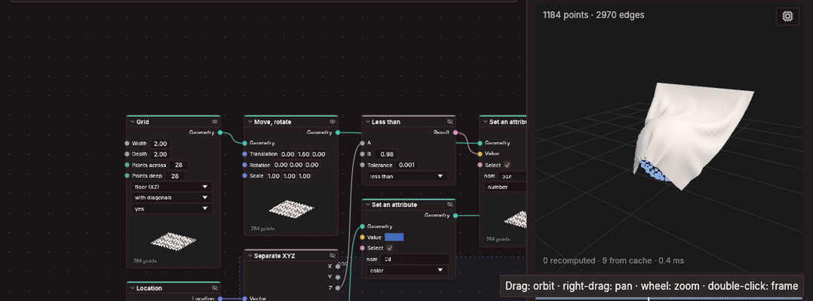
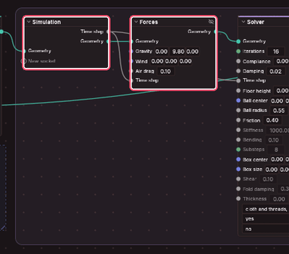
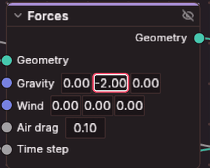

## Ce que tu vas réussir

Tu vas faire tomber un tissu sur une boule. Tu vas comprendre chaque node de la chaîne. Puis tu vas la casser et la réparer.

```essayer
exemple: tissu sur une boule
```

## Lance la lecture

```etape
Pose la souris sur l'aperçu. Appuie sur Espace. Laisse tourner jusqu'à l'image 40.
verifier: lecture.image >= 40
```



Le tissu tombe. Son bord du fond reste accroché. Le reste se pose sur la boule.

```etape
Clique le premier bouton de la barre de lecture : **Back to the first frame**.
```

## Lis le graphe de haut en bas

Le graphe a trois rangées.

**En haut, la forme de départ.** **Grid** crée le tissu. **Move, rotate** le monte. **Set an attribute** marque les points fixes.

**Au milieu, la simulation.** Deux nodes encadrent une zone : le début, et **Simulation end**. Entre les deux : **Forces**, puis **Solver**.

**En bas, la boule.** Elle est seulement montrée. L'obstacle réel se règle dans **Solver**.

## La zone de simulation

Sans zone, un graphe recalcule tout à chaque image, à partir de rien. Un tissu a besoin de mémoire : sa position d'avant, sa vitesse d'avant.

La zone donne cette mémoire.

- Ce qui est entre le début et la fin s'exécute **une fois par image**.
- Le début donne l'état de l'image d'avant.
- La fin reçoit le nouvel état.
- À la première image, l'état vient de ce qui est branché à l'entrée du début.

```etape
Repère la sortie **Time step** du node de début. Suis ses deux liens : l'un va vers **Forces**, l'autre vers **Solver**.
```



**Time step** est la durée d'une image. Les nodes de simulation en ont besoin pour avancer du bon pas.

## Forces, puis Solver

**Forces** change la vitesse des points. Par défaut, **Gravity** vaut (0, -9,8, 0) : les points accélèrent vers le bas.

**Solver** déplace les points. Il garde chaque arête à sa longueur. Il gère aussi le sol et la boule.

```attention
La longueur au repos de chaque arête est mesurée au premier pas. Le tissu garde la forme qu'il avait en entrant dans la zone.
```

## Casse, puis répare

```etape
Fais un Ctrl+clic sur le lien entre **Forces** et **Solver**. Il est coupé.
```

```etape
Reviens à la première image, puis lis. Le tissu a disparu de l'aperçu : plus rien n'arrive au **Solver**, donc plus rien n'arrive à la fin de la zone. Il reste la boule.
```

```etape
Tire un lien de la sortie de **Forces** vers l'entrée **Geometry** de **Solver**. Relance la lecture.
verifier: graphe.liens >= 17
```

## Change la gravité

```etape
Sur **Forces**, mets la composante Y de **Gravity** à -2. Reviens à la première image et lis.
```



Le tissu tombe comme sur la Lune. Remets -9,8 ensuite.

```astuce
Changer un réglage dans la zone vide les images déjà calculées. Reviens à la première image avant de relire, pour voir la chute depuis le début.
```

## Refais la zone toi-même

```etape
Ajoute une seconde zone : menu **Add**, puis **Simulation**, puis **Simulation zone**. Deux nodes arrivent d'un coup.
verifier: graphe.noeuds >= 18
```

Regarde-la, puis supprime ses deux nodes. Tu sais maintenant d'où elle vient.

```quiz
Que fait la zone de simulation ?
- [ ] Elle dessine le tissu plus vite.
- [x] Elle garde l'état d'une image à la suivante.
- [ ] Elle exporte la géométrie.
explication: Ce qui entre dans la zone repart de l'état de l'image précédente.
```

```quiz
Pourquoi le tissu n'a-t-il pas de node Move forward ?
- [x] Le Solver déplace lui-même les points.
- [ ] Le tissu ne bouge pas.
- [ ] Forces le fait déjà.
explication: Forces ne change que la vitesse. Le Solver déplace les points en gardant les arêtes à leur longueur.
```

```defi
Fais tomber le tissu de côté, comme poussé par une gravité oblique.
indice: Gravity est un vecteur. Donne une valeur à X en plus de Y.
```

## En trois lignes

- Une zone de simulation fait passer un état d'une image à la suivante.
- Dans la zone, un tissu suit la chaîne début, **Forces**, **Solver**, fin.
- **Time step** du début se relie à chaque node de simulation.

[Suite : Épingler un tissu](03-epingler-avec-un-champ.md)
