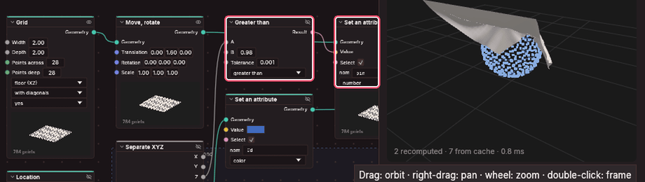
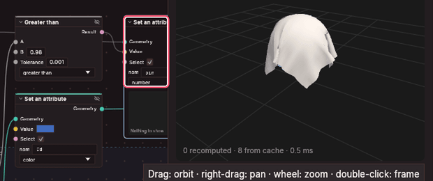

## Ce que tu vas réussir

Tu vas décider toi-même ce qui tient le tissu. D'abord un autre bord. Puis deux coins seulement. Puis rien du tout.

```essayer
exemple: tissu sur une boule
```

## Comment un point devient fixe

Les solveurs lisent un attribut nommé `pin`. Un point dont `pin` dépasse 0,5 ne bouge pas.

Dans le graphe, c'est le node **Set an attribute** de la rangée du haut qui l'écrit.

```etape
Clique ce node **Set an attribute**. Lis ses réglages : **Name** vaut `pin`, **Type** vaut **count**.
```

```attention
Le type « nombre » s'affiche **count** dans l'interface en anglais. C'est bien un nombre par point.
```

Son entrée **Select** décide quels points reçoivent la valeur. Les autres restent à 0.

## Le champ qui choisit

Regarde le cadre bleu, sous la rangée du haut. Trois nodes y sont rangés.

1. **Location** donne la position de chaque point.
2. **Separate XYZ** en tire Z.
3. **Compare**, réglé sur **less than**, avec -0,98 : vrai pour les points tout au fond.

Ces nodes n'ont pas d'entrée de géométrie. Ils sont calculés **pour chaque point**, au moment où **Select** en a besoin. C'est un champ.

```astuce
Choisis un de ces trois nodes et appuie sur P. Sa miniature s'affiche et annonce : « Field: one value per point ».
```

## Épingle le bord d'en face

```etape
Sur **Compare**, choisis **greater than**. Mets **B** à 0,98.
```

```etape
Reviens à la première image et lis jusqu'à l'image 40. Le tissu pend maintenant par l'autre bord.
verifier: lecture.image >= 40
```



## Épingle deux coins

Un coin, c'est deux conditions à la fois : tout au fond, **et** tout au bord en X.

```etape
Remets **Compare** sur **less than**, avec **B** à -0,98.
```

```etape
Ajoute un node **Math**. Choisis l'opération **absolute**. Relie la sortie **X** de **Separate XYZ** à son entrée **A**.
verifier: graphe.contient = math
```

La valeur absolue de X est grande aux deux bords, gauche et droit.

```etape
Ajoute un second node **Compare**. Relie **Math** à son entrée **A**. Mets **B** à 0,9 et choisis **greater than**.
verifier: graphe.noeuds >= 18
```

```etape
Ajoute un node **Logic**, réglé sur **and**. Relie les deux **Compare** à ses entrées **A** et **B**.
verifier: graphe.contient = logic
```

```etape
Relie la sortie de **Logic** à l'entrée **Select** de **Set an attribute**. Le nouveau lien remplace l'ancien.
```

```etape
Reviens à la première image et lis. Le tissu tient par deux coins et se creuse entre eux.
verifier: lecture.image >= 40
```

## Vérifie dans le tableau

```etape
Clique le node **Set an attribute** qui écrit `pin`. Dans **Attributes**, la colonne `pin` va de 0,00 à 1,00.
```

Si elle va de 0,00 à 0,00, aucun point n'est choisi. Ton seuil est trop sévère.

## Lâche tout

```etape
Choisis le node **Set an attribute** qui écrit `pin`. Appuie sur M. Le node devient muet : il laisse passer la géométrie sans rien écrire.
```

```etape
Reviens à la première image et lis. Le tissu tombe en entier sur la boule.
verifier: lecture.image >= 40
```



```raccourci
M : rendre un node muet, ou lui rendre la voix.
```

```attention
Ne supprime pas seulement les nodes du champ. Sans lien, **Select** vaut vrai partout : tous les points seraient fixes et le tissu resterait en l'air.
```

```quiz
Quel attribut le solveur lit-il pour savoir qu'un point est fixe ?
- [ ] `P`
- [ ] `Cd`
- [x] `pin`
explication: Un point est fixe si son attribut pin dépasse 0,5.
```

```quiz
Qu'est-ce qu'un champ ?
- [ ] Une géométrie de plus.
- [x] Une valeur calculée pour chaque point.
- [ ] Un réglage du solveur.
explication: Location, Separate XYZ et Compare donnent un résultat par point. L'entrée Select le lit point par point.
```

```defi
Fais tenir le tissu par un seul point, au centre du bord du fond.
indice: Garde le test « tout au fond ». Remplace l'autre test : la valeur absolue de X doit être plus petite que 0,05.
```

## En trois lignes

- `pin` supérieur à 0,5 : le point ne bouge pas.
- Un champ choisit les points : **Location**, **Separate XYZ**, **Compare**.
- **Logic** combine deux tests. M rend un node muet.

[Suite : Régler un tissu](04-regler-un-tissu.md)
