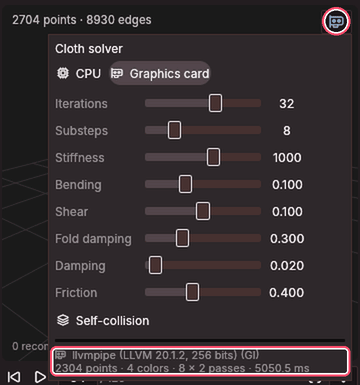
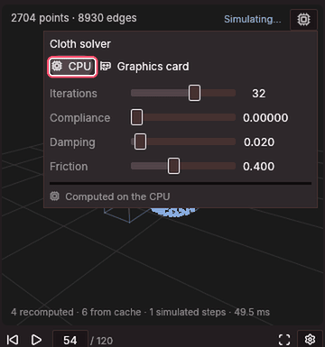

## Ce que tu vas réussir

Tu vas transformer le même tissu en jersey, en coton, puis en papier. Tu sauras quel réglage toucher quand un tissu s'étire, tremble ou refuse de se calmer.

```essayer
exemple: tissu sur la carte graphique
```

## Deux solveurs dans un seul node

Le node **Solver** a un réglage **Solver**. Il propose deux méthodes.

| | **Cloth and threads, XPBD (CPU)** | **Cloth (graphics card)** |
|---|---|---|
| Calculé sur | Le processeur | La carte graphique |
| Tenue | **Compliance** | **Stiffness**, **Shear**, **Bending**, **Substeps** |
| Flexion réglable | Non | Oui |
| Auto-collision | Non | Oui |
| Bon pour | Apprendre, petits tissus, fils | Tissus fins, beaucoup de points |

Le second utilise une méthode nommée VBD. Sans carte utilisable, il tourne quand même, sur le processeur, plus lentement.

```astuce
Sur le node, les entrées que le solveur choisi n'utilise pas sont montrées en retrait. Tu vois d'un coup d'œil ce qui compte.
```

## Le menu du tissu

```etape
Dans le coin haut droit de l'aperçu, clique l'icône de puce. Un menu s'ouvre avec les réglages du tissu.
```

Ce menu reste ouvert pendant que tu règles. En haut, deux puces : **CPU** et **Graphics card**. Dessous, les curseurs. Tout en bas, une ligne résume le dernier pas calculé.

```etape
Lance la lecture, souris sur l'aperçu, avec Espace. Laisse passer l'image 30.
verifier: lecture.image >= 30
```

```etape
Lis la ligne du bas du menu : le nom de ta carte, le nombre de **points**, de **colors**, de **passes**, et le temps du pas en millisecondes.
```



Si tu lis « No usable graphics card: cloth computed on the CPU », le calcul se fait sur le processeur. Tout le reste de la leçon marche pareil.

## Raideur : le tissu s'étire ou non

**Stiffness** est la résistance à l'étirement.

| Valeur | Tissu |
|---|---|
| 50 | Jersey |
| 1000 | Coton |
| 5000 | Jean |

```etape
Mets **Stiffness** à 50. Reviens à la première image et lis. Le tissu s'allonge sur la boule comme un tricot.
```

```etape
Remets **Stiffness** à 1000.
```

## Cisaillement : le tissu épouse ou non

Un tissu tissé se déforme facilement en biais. C'est ce qui lui permet d'épouser une boule ou une épaule. **Shear** règle cette résistance, en part de **Stiffness**.

| Valeur | Effet |
|---|---|
| 0,03 | Très souple en biais |
| 0,1 | Coton |
| 1 | Papier : il ne peut que se plier |

```etape
Mets **Shear** à 1. Relis depuis la première image. Le tissu fait de grands plis raides au lieu d'épouser la boule.
```

```etape
Remets **Shear** à 0,1.
```

```attention
**Shear** agit sur les diagonales de la grille. Il faut donc **Edges** réglé sur **with diagonals** dans le node **Grid**.
```

## Flexion : des plis fins ou larges

**Bending** est la résistance au pli.

| Valeur | Tissu |
|---|---|
| 0 | Soie |
| 0,1 | Coton |
| 1 | Toile épaisse |
| 10 | Carton |

```etape
Mets **Bending** à 10. Relis depuis la première image. Le tissu reste presque plat et bascule d'un bloc.
```

```etape
Remets **Bending** à 0,1.
```

## Deux amortissements

Ils ne font pas la même chose.

- **Damping** freine tout mouvement, comme l'air. Plus haut : le tissu tombe et se balance moins vite.
- **Fold damping** ne freine que les plis entre eux. Le tissu se pose et se calme, sans tomber plus lentement.

```etape
Mets **Fold damping** à 0. Relis. Une fois posé, le tissu frémit encore.
```

```etape
Mets **Fold damping** à 1. Relis. Le tissu se calme vite. Sa chute, elle, dure autant.
```

Reviens à 0,3 ensuite.

## Itérations et sous-pas

**Iterations** est le nombre de passes de calcul par image. **Substeps** coupe l'image en sous-pas. Les itérations sont réparties entre eux : 32 itérations et 8 sous-pas donnent 4 passes par sous-pas.

Beaucoup de sous-pas, avec peu de passes chacun, donnent le tissu le plus ferme et les contacts les plus propres.

```etape
Mets **Substeps** à 1. Relis. Le tissu traverse plus facilement la boule et s'étire.
```

```etape
Remets **Substeps** à 8.
```

### Les niveaux grossiers

À chaque sous-pas, le solveur corrige d'abord l'étirement du tissu entier. Il s'aide de versions plus grossières du même tissu. Tu n'as rien à régler : c'est automatique.

Grâce à eux, un tissu fin reste aussi ferme qu'un tissu grossier, sans des centaines d'itérations. Cette correction coûte environ deux passes, retirées de celles que tu demandes.

## Et sur le processeur ?

```etape
Dans le menu du tissu, clique la puce **CPU**. Les curseurs changent : il reste **Iterations**, **Compliance**, **Damping** et **Friction**.
```



**Compliance** est la souplesse des fils. À 0, le tissu ne s'étire pas. Plus grand, il devient élastique. La flexion ne se règle pas : seule la finesse de la grille compte.

```etape
Reclique la puce **Graphics card** pour la suite.
```

## Le pense-bête

| Problème | Geste |
|---|---|
| Le tissu s'étire comme du caoutchouc | Monte **Iterations**, **Substeps** ou **Stiffness** |
| Le tissu explose ou tremble | Baisse **Stiffness** ou monte **Substeps**. Vérifie le lien **Time step** |
| Le tissu ressemble à du papier | Baisse **Shear** et **Bending** |
| Le tissu ne se calme pas | Monte **Fold damping** |
| Tout le tissu oscille | Monte **Damping**, ou **Air drag** dans **Forces** |

```quiz
Ton tissu se pose mais ses plis frémissent sans fin. Quel réglage montes-tu ?
- [ ] Stiffness
- [x] Fold damping
- [ ] Iterations
explication: Fold damping calme les plis sans ralentir la chute. Damping freinerait aussi la chute.
```

```quiz
Quel réglage laisse un tissu épouser une boule ?
- [x] Un Shear bas.
- [ ] Un Bending haut.
- [ ] Un Damping haut.
explication: Un tissu qui cède en biais peut suivre une forme ronde. À 1, il se comporte comme du papier.
```

```quiz
Que sont les niveaux grossiers ?
- [ ] Un réglage à activer sur le node.
- [x] Une correction automatique de l'étirement, faite à chaque sous-pas.
- [ ] Un mode d'aperçu plus rapide.
explication: Le solveur s'aide de versions plus grossières du tissu. Il n'y a rien à régler.
```

```defi
Règle une soie lourde : elle s'étire peu, épouse tout, fait des plis très fins et se calme vite.
indice: Stiffness haut, Shear bas, Bending à 0, Fold damping haut.
```

## En trois lignes

- **Stiffness** règle l'étirement, **Shear** le biais, **Bending** le pli.
- **Damping** freine tout. **Fold damping** ne calme que les plis.
- Plus de **Substeps** : un tissu plus ferme et des contacts plus propres.

[Suite : Obstacles et auto-collision](05-obstacles-et-auto-collision.md)
