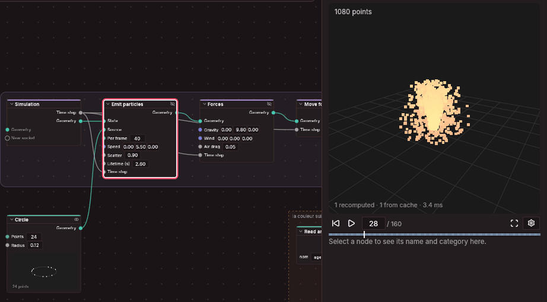
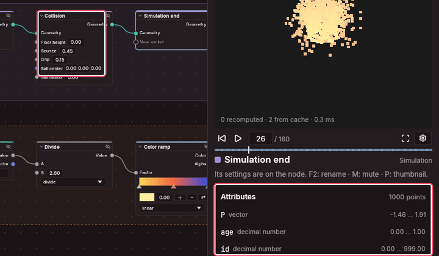

## Ce que tu vas réussir

Tu vas régler une fontaine de particules : son débit, sa hauteur, ses rebonds. Puis tu vas animer une surface de vagues avec une seule formule.

## Partie 1 : la fontaine

```essayer
exemple: fontaine de particules
```

```etape
Lis jusqu'à l'image 60. Des particules jaillissent, retombent et rebondissent. Leur couleur change avec l'âge.
verifier: lecture.image >= 60
```



### La chaîne des particules

Dans la zone de simulation, quatre nodes se suivent.

| Node | Ce qu'il fait |
|---|---|
| **Emit particles** | Fait naître des particules à chaque image. Les fait vieillir. Retire celles qui ont fait leur temps |
| **Forces** | Change leur vitesse : gravité, vent, frottement de l'air |
| **Move forward** | Déplace chaque point selon sa vitesse |
| **Collision** | Les fait rebondir sur le sol et sur une boule |

Ici, pas de **Solver**. Rien ne relie les particules entre elles. C'est donc **Move forward** qui les déplace.

```etape
Suis la sortie **Time step** du début de la zone. Elle nourrit **Emit particles**, **Forces** et **Move forward**.
```

### D'où naissent les particules

**Emit particles** a deux entrées de géométrie. **State** reçoit les particules de l'image d'avant. **Source** reçoit la forme d'où elles naissent : ici un petit **Circle**.

```etape
Sur **Circle**, mets **Radius** à 0,6. Relis depuis la première image. La fontaine devient une couronne.
```

Remets 0,12.

### Débit, vitesse, dispersion, durée de vie

```etape
Sur **Emit particles**, mets **Per frame** à 100. Relis. Le jet est plus dense.
```

```etape
Mets la composante Y de **Speed** à 8. Le jet monte plus haut.
```

```etape
Mets **Scatter** à 0. Toutes les particules suivent le même chemin : le jet devient un trait.
```

**Scatter** ajoute du hasard à la vitesse de départ. Remets 0,9.

```etape
Mets **Lifetime (s)** à 1. Les particules disparaissent en l'air, avant de toucher le sol.
```

Remets 2,6.

```attention
**Emit particles** refuse de dépasser 4 millions de particules. Un message le dit. Baisse alors **Per frame** ou **Lifetime (s)**.
```

### Les colonnes d'une particule

```etape
Clique le node **Simulation end**. Lis la carte **Attributes**.
```



Tu y trouves `P` et `v`, plus deux colonnes nouvelles : `age`, l'âge en secondes, et `id`, un numéro unique par particule.

La couleur lit cet âge. Regarde le cadre orange : **Read an attribute**, réglé sur `age`, puis **Math** qui divise par la durée de vie, puis **Color ramp**.

### Rebonds

```etape
Sur **Collision**, mets **Bounce** à 0,9. Relis. Les particules rebondissent presque aussi haut qu'elles sont tombées.
```

```etape
Mets **Grip** à 1. Au contact du sol, les particules cessent de glisser.
```

```etape
Mets **Ball radius** à 0,5 et **Ball center** à (0,8, 0,5, 0). Relis. Les particules ricochent sur une boule invisible.
verifier: lecture.image >= 60
```

```astuce
Pour voir la boule, fais comme dans le tissu : **Points on a sphere**, puis **Move, rotate**, puis **Merge** avant la sortie.
```

## Partie 2 : les vagues

```essayer
exemple: vagues animées
```

```etape
Lis quelques images, puis clique n'importe où dans la bande sous la barre de lecture. L'image arrive tout de suite.
verifier: lecture.image >= 20
```

### Pas de zone, pas de mémoire

Ce graphe n'a pas de zone de simulation. Chaque image est calculée seule, à partir du temps. Il n'y a rien à mettre en cache d'une image à l'autre : sauter à l'image 90 ne coûte pas plus que l'image 2.

La règle pour choisir :

- le mouvement dépend de ce qui s'est passé avant : **simulation** ;
- le mouvement s'écrit comme une formule du temps : **champ**.

### La formule

```etape
Clique le node **Expression**. Lis sa formule. `x` et `z` sont la position du point. `a` reçoit l'image courante, par le node **Time**.
```

Le résultat entre dans **Y** d'un **Combine XYZ**, puis dans l'entrée **Offset** de **Set point positions**. Chaque point monte et descend selon sa place et le temps.

```etape
À la fin de la formule, remplace `0.18` par `0.4`. Les vagues sont plus hautes.
verifier: graphe.contient = expr
```

```etape
Regarde la couleur : les crêtes ne sont plus aussi claires. Le node **Map range** attend encore des hauteurs entre -0,18 et 0,18. Mets **from min** à -0,4 et **from max** à 0,4.
```

```quiz
Pourquoi la fontaine a-t-elle un node Move forward, et pas le tissu ?
- [ ] Les particules sont plus légères.
- [x] Aucun Solver ne déplace les particules : il faut le faire d'après leur vitesse.
- [ ] Move forward crée les particules.
explication: Forces ne change que la vitesse. Sans Solver, c'est Move forward qui applique cette vitesse aux positions.
```

```quiz
Les vagues n'ont pas de zone de simulation. Pourquoi ?
- [x] Leur forme est une formule du temps : aucune mémoire n'est nécessaire.
- [ ] Les zones ne marchent pas avec une grille.
- [ ] Elles sont figées sur le disque.
explication: Chaque image se calcule seule. Une zone ne sert que si l'état dépend de l'image d'avant.
```

```defi
Transforme les vagues en ronds dans l'eau, qui partent du centre.
indice: Dans la formule, utilise la distance au centre : `sin(length(x, z) * 8 - a * 0.3) * 0.1`
```

## En trois lignes

- Particules : **Emit particles**, **Forces**, **Move forward**, **Collision**.
- Chaque particule porte `age` et `id`. Tu peux les lire pour colorer.
- Un mouvement qui s'écrit en formule du temps n'a pas besoin de zone.

[Suite : Projet, un drapeau puis une nappe](08-projet-drapeau-et-nappe.md)
