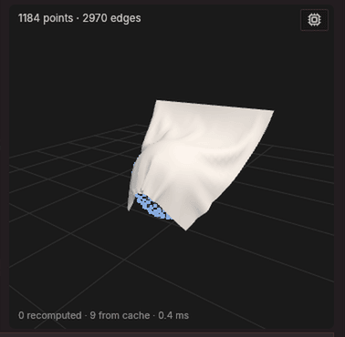

## Ce que tu vas apprendre

Dans Aryadne, une simulation est un graphe de nodes. Le fichier porte l'extension `.arygeo`. Il s'ouvre dans l'outil **Simulation** de l'étape **3D**.



Ce parcours part de zéro. À la fin, tu sais monter un tissu, le régler, le faire tenir sur des obstacles et le relire sans attendre.

## Les leçons

1. [Une géométrie est un tableau](01-geometrie-en-colonnes.md) : points, colonnes, attributs.
2. [Ta première simulation](02-premiere-simulation.md) : la zone de simulation, **Forces**, **Solver**.
3. [Épingler un tissu](03-epingler-avec-un-champ.md) : l'attribut `pin` et les champs.
4. [Régler un tissu](04-regler-un-tissu.md) : deux solveurs, raideur, flexion, cisaillement, amortissements.
5. [Obstacles et auto-collision](05-obstacles-et-auto-collision.md) : sol, boule, boîte, frottement, épaisseur.
6. [Vent, lecture et cache](06-vent-lecture-et-cache.md) : faire souffler, relire, figer sur le disque, mesurer ta carte.
7. [Particules et vagues](07-particules-et-vagues.md) : une fontaine, puis une surface qui ondule.
8. [Projet : un drapeau, puis une nappe](08-projet-drapeau-et-nappe.md) : tout mettre ensemble, avec ou sans l'Assistant.
9. [Fumée et feu](09-fumee-et-feu.md) : un volume, une source, le solveur de fumée, la combustion, un obstacle.

## Ce qu'il faut savoir avant

Tu sais ajouter un node et tirer un lien. Sinon, fais d'abord [Les principes des nodes](../12-noeuds/01-principes.md).

```astuce
Dans l'onglet **Simulation**, l'aperçu montre le tissu par ses points et ses arêtes : c'est fait pour régler vite. Pour le voir ombré, avec un matériau, et le rendre, pose-le dans une scène 3D : menu **Add**, **Node geometry**. Le [projet 2](../16-projets/02-plan-anime-rendu-et-monte.md) le fait de bout en bout.
```

Pour chercher un réglage précis plus tard, garde sous la main les guides [Simulation de tissu](../../utilisateur/simulation-tissu.md) et [Fumée et feu](../../utilisateur/simulation-fumee.md).
